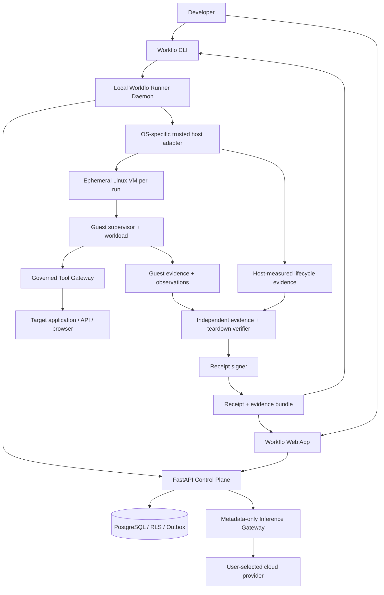

# Workflo — Implementation Blueprint

**Document type:** Engineering implementation specification  
**Repository reviewed:** `Kshitij-Tripathi87/workflo`  
**Reviewed base:** `main` at `5e82478572af26335906686c06703d41df4c3d1f` (21 November 2026)  
**Status:** Proposed implementation baseline; decisions requiring owner ratification are called out explicitly.

> **Purpose.** Deliver a working Workflo prototype that a developer can install, configure with a local or cloud AI provider, point at a repository, execute inside an isolated environment, inspect the evidence, and independently verify a signed execution receipt. The design must keep the local CLI, customer runner, web application, provider adapters, sandbox runtimes and receipt format on one coherent contract.

---

## 0. Executive decision

Workflo will be built as a **customer-controlled software execution and verification system**. It will not be a general-purpose coding agent, a source-code hosting platform, or a generic sandbox wrapper.

The core product loop is:

1. Identify an exact repository snapshot and declared run policy.
2. Admit the request only when the selected runner and isolation backend satisfy that policy.
3. Execute declared checks and start the application inside an ephemeral VM.
4. Let a bounded agent inspect permitted information and exercise the application through governed tools.
5. Collect evidence independently of the untrusted workload.
6. Shut down the VM and verify the host-side resources were removed.
7. Sign a receipt that binds the source identity, policy, runtime, outcomes, evidence and teardown verification.
8. Allow a separate verifier to validate the receipt and evidence offline.

The system must report three distinct outcomes. Do not collapse them into a single green check:

| Dimension | Question | Example values |
|---|---|---|
| **Execution** | Did the requested run complete? | completed, cancelled, infrastructure failure, policy rejected |
| **Quality / QA** | What did the declared checks and probes find? | passed, failed, inconclusive, not run |
| **Trust** | Is the evidence and runtime teardown verifiable? | verified clean, verification failed, cleanup incomplete, unknown |

A test failure can be a valid completed execution. An application failure is a QA result, not automatically a Workflo infrastructure failure. A passing test with unverified cleanup is not a trusted success.

### 0.1 Architecture selected after repository inspection

**Keep the existing Python product lineage as the canonical runtime.** The repository has already made that choice in `PRODUCT_BOUNDARIES.md`, `docs/reconciliation/PHASE_0_WORKFLO_TRUST.md`, and ADR-0015 (proposed, pending ratification). Do not rewrite the CLI and runtime in TypeScript just because the web UI is TypeScript.

| Layer | Canonical technology / location | Responsibility |
|---|---|---|
| CLI | Python 3.11+, Click; `apps/workflo-cli` | Installable developer interface, init, doctor, config, run, inspect, report, verify |
| Shared contracts | Pydantic v2; `packages/workflo-schema` | RunSpec, policy, lifecycle, events, findings, evidence, inference and receipt schemas |
| Control plane | FastAPI + PostgreSQL; `apps/control-plane` | Identity, project config, run admission/dispatch, provider credentials, remote runner coordination, event projection |
| Host runner | `worker/` | Trusted host boundary, VM lifecycle, limits, egress, guest protocol, host evidence and teardown verification |
| Guest workload | `apps/worker-engine` plus guest image/runtime | Repo preparation, deterministic tests, app startup, bounded agent tools, browser/API probes and guest evidence |
| Development runtime | `apps/sandbox-executor`, `supervisor/`, `packages/sandbox-runtime` | Local development/CI only; clearly labelled non-production runtime |
| Model adapters | Consolidated into `apps/worker-engine/src/workflo_worker/model/` | Local endpoint adapters and metadata-only cloud gateway client |
| Web product | Next.js app in `apps/dashboard` | Settings, projects, connected runners, run timeline, reports, receipts and evidence navigation |
| Marketing/download site | `website/` | Product pages, CLI installation/downloads, docs and link to web app |
| Cross-language UI types | `packages/contracts` (validated mirror only) | Zod types generated/checked against Python-exported JSON Schema |

**Do not extend** `packages/sandbox/` (TypeScript bwrap runtime), `backend/` or `frontend/` for Workflo Trust features. The latter pair belong to the adjacent Cortex Autopilot product. Do not create a second Firecracker manager under `apps/sandbox-executor`.

### 0.2 What is already real vs what remains

The repository is a development preview, not a release-ready, end-to-end product. Current source must be treated as the truth; previous planning notes are not proof of current integration.

| Capability | Current repository evidence | Implementation status for this plan |
|---|---|---|
| Python CLI | `apps/workflo-cli`; commands include init, doctor, run, run-dev, status, verify, inspect, explain, keygen, config and auth | Existing; consolidate and harden rather than replace |
| Development sandbox | Docker / Linux namespace runtime under `apps/sandbox-executor`, `packages/sandbox-runtime`, `supervisor/` | Existing development/CI path only; never label as production isolation |
| Firecracker host manager | `worker/src/workflo_worker_host/manager.py`, admission, assignment, protocol, VMM client and network modules | Foundation exists; real Gate B boot/containment/teardown evidence remains required |
| Guest lifecycle | Guest supervisor/capability and fixed offline workload added in latest merge PR #22 | Narrow microVM slice; not yet a full repo build/test/agent workload |
| Receipt and evidence | Pydantic contracts in `packages/workflo-schema`, including DSSE receipt v5; legacy v1–v4 verifier paths | Good contract foundation; needs end-to-end binding and verifier hardening |
| Control plane | FastAPI service, authentication, durable PostgreSQL dispatch/outbox, inference endpoint | Existing foundation; runner dispatch and run lifecycle need canonical wiring |
| Agent probes | `apps/worker-engine`: test runner, ToolGateway, browser/API/log capabilities and planner loop | Partial capability layer; needs complete governed orchestration within guest |
| AI providers | Existing local llama.cpp/GGUF path, direct endpoint compatibility code and metadata gateway | Fragmented; privacy bypass exists in legacy direct path; requires single provider policy |
| Dashboard | `apps/dashboard` Next.js shell currently branded Tenant Shield | Replace shell with Workflo workflows, do not build a second UI |
| Website | `website/` active marketing site | Add installation and dashboard entry points |
| Multi-OS execution | No proven local strict backend for each OS | CLI/web client portability + per-OS VM adapters and independent security acceptance required |
| CI integration | GitHub workflows and Action scaffolding exist | Postpone user-facing GitHub Action until local vertical slice and receipts stable |

### 0.3 Non-negotiable product invariants

1. The guest and all repository-controlled material are untrusted.
2. No source code or raw source-bearing content is sent to a hosted model.
3. Every cloud inference request goes through Workflo's metadata-only privacy gateway.
4. No direct-to-cloud provider call from the CLI, guest or browser is permitted.
5. Local models may receive repository context only when local inference is explicitly selected and the endpoint is verified to be user-controlled/local.
6. A model proposes actions; Workflo policy code decides whether those actions are allowed.
7. No arbitrary shell tool is exposed to the model. Run commands are declared, bounded and mediated by the guest supervisor.
8. The host does not execute project code or offer a general host shell API to the guest.
9. Production execution of untrusted code requires an approved VM backend. No Docker, bwrap, WSL or local-development fallback may be labelled equivalent.
10. Cleanup is independently measured. A cleanup command returning success is not sufficient evidence.
11. Evidence is separated by source and trust level: host-measured, guest-reported, agent-observed and model-generated.
12. A signed receipt proves integrity and signer identity for its claims; it does not prove absence of defects or absolute security.
13. CLI, web app, local runner and later CI integration use the same versioned RunSpec, event, evidence and receipt contracts.
14. Repair suggestions are advisory. Workflo does not silently edit the user's checkout or apply a patch.
15. Any unproven security condition fails closed and is reported explicitly.

---

## 1. Product prototype definition

### 1.1 Prototype user journey

A new user must be able to:

1. Visit the Workflo website and install the CLI on Linux, Windows or macOS.
2. Open the Workflo web app, create a project and connect a customer-controlled runner, or use the CLI locally.
3. Run `workflo init` in a project. Workflo detects language, package manager, available test commands and app entry points without silently changing source files.
4. Configure an inference profile in Settings or with the CLI. The user may select a supported local endpoint or cloud provider.
5. Run `workflo doctor --full` to see the selected operating system, hypervisor/backend readiness, provider connectivity, permissions, network policy capability and release-gate status.
6. Start a run against a full Git commit or a content-addressed local snapshot. Dirty working-tree handling must be explicit.
7. Watch the run lifecycle and event stream in the CLI or web app.
8. Review test outcomes, API/browser probes, structured logs, agent actions, denials, failure analysis and advisory repair suggestions.
9. Download a report, evidence bundle and signed receipt.
10. Run the offline verifier without contacting the control plane or model provider.

### 1.2 Prototype scope (must be demonstrated, not just represented in code)

**Required in the first end-to-end prototype:**

- CLI install and doctor flow on Linux, Windows and macOS.
- A local customer runner/daemon with authenticated outbound connection to the control plane.
- At least one approved strict VM execution path (Linux Firecracker/KVM) and clear development-only status for unapproved paths.
- End-to-end repository snapshot → guest workload → checks → app startup → API + browser probes → structured logs → agent activity → teardown → receipt.
- One local inference provider and at least two cloud providers through the same privacy gateway interface; provider registry must be open to additional models.
- All nine user-approved agent capabilities (repository inspection, tests, app startup, API, browser, logs, failure analysis, activity ledger, advisory repair suggestions), with cloud/local permissions differentiated.
- A useful Next.js dashboard flow: project, runner, provider settings, run timeline, report and receipt verification.
- Offline independent receipt/evidence verifier.
- A realistic hostile fixture and an explicit isolation/security negative-test run.

**Not in the first prototype:**

- Automatic code modification or patch application.
- Autonomous merge, deployment, production rollback or write-back.
- General remote code editor/IDE.
- Hosted GPU fleet managed by Workflo.
- Enterprise SSO/SCIM and compliance certifications.
- A customer-visible CI marketplace action before local workflow is stable.
- Claiming Windows/macOS strict local isolation until their adapters pass separate release gates.

### 1.3 Platform support policy

The product supports installation and control-plane access on all three desktop OS families. **Execution assurance is backend-specific.** These must not be marketed as the same thing.

| Host | Planned strict local backend | Important constraints | Until adapter passes its security gate |
|---|---|---|---|
| Linux x86_64/arm64 | Firecracker + KVM + jailer | `/dev/kvm`, pinned Firecracker/jailer, approved guest kernel/rootfs, cgroups, network controls, seccomp and host hardening | Development mode only, or connect to a certified remote Linux runner |
| macOS Intel/Apple Silicon | Apple Virtualization.framework running a Linux guest | Native Swift helper; virtualization entitlement, signed/notarized distribution, per-architecture guest artifacts; verify socket and disk isolation | Use connected certified Linux runner; do not call Docker Desktop or a shared directory equivalent to strict isolation |
| Windows x64 | Hyper-V running a Linux guest | Hyper-V available on supported editions/host hardware; native helper; Windows Home is not assumed to support local Hyper-V | Use connected certified Linux runner; do not silently fall back to WSL2/Docker as strict mode |

Firecracker documentation describes Linux/KVM and supported host architectures; Apple documents Virtualization.framework and its entitlement requirement; Microsoft documents Hyper-V architecture and installation requirements. See [source register](#appendix-a-external-technical-references).

A shared VM guest protocol and guest image reduce divergence, but the host adapters, VM transports, disk lifecycle, network isolation, force termination and teardown probes are OS-specific. Each backend must pass its own independent adversarial gate. The CLI must show `STRICT READY`, `DEVELOPMENT ONLY`, or `REMOTE RUNNER REQUIRED` rather than a vague green “ready”.

---

## 2. Target architecture

### 2.1 Component view



**Trust boundary:** CLI/web/control plane coordinate requests and persist metadata. The host runner owns the VM and trusted lifecycle checks. The guest VM runs the repository, dependencies, test commands, app, agent tools and untrusted data. The hosted provider only sees positively allowlisted, sanitized observations. The model never executes tools directly.

### 2.2 Execution sequence

```mermaid
sequenceDiagram
    participant U as User / CLI / Web
    participant C as Control Plane
    participant R as Customer Runner
    participant H as Trusted Host Adapter
    participant G as Guest VM
    participant V as Verifier / Signer
    participant M as Model Provider
    U->>C: Submit RunSpec + exact source identity
    C->>C: Authenticate, validate policy, create run + attempt + outbox
    C->>R: Dispatch signed assignment (outbound runner channel)
    R->>H: Admit backend, resources, runtime and policy
    H->>H: Apply default-deny network and provision fresh VM/disk
    H->>G: Deliver attempt-bound one-time capability
    G->>H: Guest ready after identity verification
    G->>G: Prepare snapshot, install/check dependencies per policy, run tests
    G->>G: Start app and create bounded test environment
    G->>M: Only typed metadata observations via privacy gateway (cloud)
    M-->>G: Schema-validated proposed plan
    G->>G: Policy-check each step, execute allowed API/browser/log tools
    G->>H: Evidence manifest, lifecycle and final status
    H->>G: Graceful shutdown; then force terminate if deadline exceeded
    H->>H: Independently verify VM/process/disk/network/socket/capability cleanup
    H->>V: Host facts + guest evidence + policy/source/runtime identities
    V->>V: Verify hashes, evidence chain, outcomes and teardown gate
    V->>V: Sign receipt only if signing policy permits
    V-->>C: Receipt, evidence, trust/QA/execution results
    C-->>U: Timeline + report + downloadable proof bundle
```

### 2.3 Responsibility boundaries

| Component | Must do | Must never do |
|---|---|---|
| CLI | Capture user intent, resolve local repo/snapshot, display status, call daemon/API, verify receipt | Send repository source to a cloud API; store provider secrets in plain config; run project code directly on host |
| Runner daemon | Authenticate to control plane, accept only signed assignments, own a local queue and runner heartbeat, route requests to host adapter | Accept arbitrary inbound network requests; expose host shell; trust unsigned run instructions |
| Control plane | Authorize user/project, persist RunSpec, enforce RLS, dispatch through durable outbox, hold encrypted BYOK secrets, expose metadata-only gateway | Download user repository source; mount user filesystem; forward unvalidated logs/source to a provider |
| Host adapter | Admit, provision, monitor, terminate and independently inspect VM resources | Execute repository commands or access guest source contents; expose generic shell or host filesystem to guest |
| Guest supervisor | Validate one-time capability; execute only typed operations; enforce command/tool/resource caps; emit evidence | Escape guest boundary, obtain host secrets, elevate privileges, change policy or self-authorize actions |
| Agent | Plan probes from allowed context and observations; request tools | Invoke arbitrary shell, bypass tool gateway, directly reach host or external services |
| Verifier | Validate schemas, hashes, signatures, policy/runtime binding and teardown results | Trust model-generated summaries as measured facts; infer security from a valid signature alone |
| Dashboard | Display metadata, event timeline, sanitized report and receipt; configure profiles | Read local repo files unless connected runner has explicitly provided a scoped operation; store API secrets in browser storage |

### 2.4 Run lifecycle authority

Use the existing Python Pydantic lifecycle and outcomes in `packages/workflo-schema/src/workflo_schema/contracts/` as canonical. The TypeScript `packages/contracts` types are a checked mirror, not a second contract author.

Canonical product lifecycle (`LifecycleState` in `packages/workflo-schema/src/workflo_schema/contracts/lifecycle.py`):

```text
CREATED -> ADMITTED
ADMITTED -> PROVISIONING | REJECTED
PROVISIONING -> SOURCE_ACQUISITION | INFRASTRUCTURE_FAILED | CANCEL_REQUESTED
SOURCE_ACQUISITION -> PREPARING | EXECUTION_FAILED | CANCEL_REQUESTED
PREPARING -> EXECUTING | EXECUTION_FAILED | CANCEL_REQUESTED
EXECUTING -> EVALUATING | EXECUTION_FAILED | CANCEL_REQUESTED
EVALUATING -> COLLECTING_EVIDENCE
COLLECTING_EVIDENCE -> TEARDOWN
TEARDOWN -> VERIFYING_TEARDOWN
VERIFYING_TEARDOWN -> SIGNING | TEARDOWN_FAILED
SIGNING -> COMPLETED | ATTESTATION_FAILED
CANCEL_REQUESTED -> TEARDOWN
```

The enum and `LEGAL_TRANSITIONS` map in `workflo-schema` are authoritative. Do not add intermediate product states such as `QUEUED`, `RUNNING`, or `FINALIZING`; report those as events/operational stages if needed, not as lifecycle states.

The lifecycle terminates in an execution status, while QA verdict and trust verification remain independent outcome axes. In particular, `EXECUTION_FAILED` is not a substitute for a QA verdict: set `qa_verdict` from validated check evidence; set `trust_status` from evidence/teardown verification. A run can complete with a verified QA failure (`execution_status=completed`, `qa_verdict=fail`, `trust_status=verified_clean`). Teardown or attestation failure prevents a clean-trust claim.

Important distinctions:

- Policy rejection before execution: no sandbox, no QA claim.
- A test or application failure: valid QA failure if all expected test evidence was collected and infrastructure cleanup is sound.
- Missing test results, worker crash or invalid report: inconclusive/infrastructure failure, not “all tests passed”.
- Teardown failure: trust outcome is not clean; receipt must not claim verified clean.
- Cancellation is a request, not proof of termination. The host must continue tracking until termination/cleanup outcome is established.
- Every transition must be authorized by the service that owns it and recorded as a signed/append-only event where applicable.

### 2.5 Canonical RunSpec

Extend existing canonical schema, do not invent a second run JSON. RunSpec must bind:

```yaml
api_version: workflo.dev/v1
kind: Run
metadata:
  run_id: <uuid>
  project_id: <id>
  idempotency_key: <opaque>
source:
  type: git | local_snapshot
  repository_url: <optional>
  requested_ref: <optional>
  commit: <full immutable commit if git>
  snapshot_digest: sha256:<digest>
  dirty_worktree: false
execution:
  profile: strict | development
  runtime_class: microvm
  checks:
    - id: unit-tests
      command: ["<detected executable>", "<fixed arguments>"]
      timeout_seconds: 600
  app:
    start_command: ["<binary>", "<args>"]
    healthcheck: {type: http, path: /health, port: 0}
  agent:
    enabled: true
    mission: "Test login and checkout flows"
    capabilities: [repo_metadata, tests, app_health, api, browser, logs, analysis]
    max_steps: 80
    max_duration_seconds: 600
  resources:
    vcpus: 2
    memory_mib: 4096
    disk_mib: 8192
    wall_clock_seconds: 1800
  network:
    default: deny
    allow_rules: []
inference:
  profile_id: <user-selected profile>
  mode: local | cloud
  source_policy: local_only
report:
  formats: [json, markdown]
```

This is illustrative, not yet a committed schema. Exact fields/enums and validation rules are to be reconciled with `RunSpec`, policy, outcome and receipt models in `packages/workflo-schema`. Commands must be argv arrays, not concatenated shell strings. If the product detects a shell-form config for compatibility, it must convert/validate with an explicit warning and never silently accept metacharacter expansion.

---

## 3. Repository implementation map

### 3.1 Active surfaces — extend these

| Path | Work required | Avoid |
|---|---|---|
| `apps/workflo-cli/` | Consolidate config/provider commands, local snapshot, `run`, `status`, `report`, provider tests, daemon management and verify UX | New Node CLI or breaking old flags |
| `packages/workflo-schema/` | Complete RunSpec, provider settings, agent capability, platform/runtime identity, evidence source, receipt and JSON Schema exports | A second schema authored in TS |
| `apps/control-plane/` | Durable assignment/heartbeat, runner channel, project/provider config, encrypted provider-secret management, run query/event APIs, gateway adapter registry | A second API in `backend/` |
| `worker/` | Finish Firecracker/KVM backend, real resource enforcement and independent teardown; define backend protocol for macOS/Windows | Second Firecracker manager or arbitrary host execution endpoint |
| `apps/worker-engine/` | Integrate fixed guest slice with repo snapshot, runtime preparation, tests, web/API probes, local/cloud planning and report generation | Guest trust in arbitrary host-shared files |
| `supervisor/`, `packages/sandbox-runtime/` | Keep dev/CI mode reliable; clear `runtime_type=namespaces` and non-production warnings | Claiming these satisfy strict runtime |
| `apps/dashboard/` | Build actual Workflo interface and call control-plane APIs | Expanding legacy Cortex `frontend/` |
| `website/` | CLI installation, quick start, downloads, docs, dashboard link | Duplicating dashboard application logic |
| `workflo-ai-integration/` | Move reusable model router/safety gate into worker model package after contract review; migrate tests; archive old path | Maintaining two independently evolving routers |

### 3.2 Freeze / compatibility surfaces

- `packages/sandbox/` TypeScript sandbox runtime: keep its tests green but no new sandbox capability investment.
- `backend/` and `frontend/`: adjacent Cortex Autopilot, not Workflo Trust.
- Root legacy Vite/Express files and historical prototypes: don't expand.
- `apps/sandbox-executor/`: development executor only; no Firecracker host implementation.
- Existing `/v1` API response and DB compatibility fields: preserve while a versioned canonical lifecycle is adopted.
- Receipt v1–v4: continue verifying old receipts byte-for-byte. New runs use canonical receipt v5 or a new version if v5 is already frozen/issued with incompatible shape changes.

### 3.3 Contract authority and receipt version decision

ADR-0015 currently says canonical contracts in `packages/workflo-schema` but is marked proposed/pending ratification. Ratify it before feature work. The repo has both a legacy `workflo_schema.sandbox.SignedReceipt` v1–v4 and the canonical `workflo_schema.contracts.receipt.ReceiptV5Payload` DSSE contract. New feature work must only write the canonical v5 format. Keep a compatibility verifier for legacy v1–v4.

If multi-platform identity fields or inference privacy evidence are added before the first v5 production receipt, update v5 schema and exported JSON Schema. If v5 has already been released, do **not** change its canonical bytes; introduce v6 for any required payload evolution. The compatibility rule is stronger than a desire to keep one current version.

---

## 4. Sandbox and operating-system architecture

Detailed security requirements and per-platform acceptance matrices are in [02-platform-sandbox-security.md](02-platform-sandbox-security.md).

### 4.1 Shared backend interface

Define one narrow host backend protocol in the Python worker-host package, with OS-specific implementations behind it:

```python
class SandboxBackend(Protocol):
    backend_id: str
    platform: str

    def probe(self) -> BackendCapabilities: ...
    def admit(self, assignment: SandboxAssignmentV1) -> AdmissionResult: ...
    def provision(self, assignment: SandboxAssignmentV1) -> SandboxHandle: ...
    def deliver_capability(self, handle: SandboxHandle, capability: GuestCapabilityV1) -> None: ...
    def wait_ready(self, handle: SandboxHandle, timeout: float) -> GuestReady: ...
    def collect_evidence(self, handle: SandboxHandle) -> GuestEvidence: ...
    def request_shutdown(self, handle: SandboxHandle, deadline: float) -> None: ...
    def force_terminate(self, handle: SandboxHandle) -> TerminationResult: ...
    def verify_teardown(self, handle: SandboxHandle) -> TeardownVerificationV1: ...
```

The guest sends typed framed protocol messages. Backends map the transport to Firecracker VSOCK, Hyper-V Socket/VMBus or an Apple Virtualization socket mechanism. The exact macOS/Windows transport is a technical spike and must be proven with a real guest before being frozen into a contract. No backend may add a generic `execute_command` method.

### 4.2 Isolation profiles

| Profile | Runtime | Intended use | Receipt treatment |
|---|---|---|---|
| `strict` | Certified microVM backend for the selected host | Untrusted repository execution | Eligible for strict trust claim only after that backend's security gate passes |
| `development` | Existing namespace/Docker path | Local dev and ordinary CI regression | Always marked non-strict; cannot satisfy strict security gate |
| `remote-strict` | Customer-controlled certified runner, normally Linux/KVM first | Host OS cannot provide certified local runtime | Receipt binds remote runner identity and actual VM backend |
| `dry-run` | No sandbox, no commands | Plan validation only | No execution or trust claim |

There is no `strict -> development` fallback. If strict backend is unavailable, return `RUNNER_REQUIRED`/`BACKEND_INELIGIBLE` and explain how to connect an approved runner.

### 4.3 Guest image

Build a deterministic, signed, versioned Linux guest image with:

- Minimal read-only base root filesystem.
- Workflo guest supervisor and typed protocol runtime.
- Python runtime and approved runtime helpers.
- Node.js/Playwright/browser dependencies only in a separately versioned web-capable image/profile.
- No cloud provider secrets, no user OS credential stores, no SSH agent, no host mounts.
- Explicit unprivileged workload UID/GID.
- Resource ceilings, file descriptor limits, process count and filesystem quotas.
- Immutable image digest and source build provenance.
- A guest boot handshake which includes guest image digest and protocol version.

Avoid shipping every language/browser stack in a single huge image. Use a minimal base image plus signed, digest-pinned runtime layers or profiles. The exact model and runtime artifacts must be captured in a bill of materials/manifests.

---

## 5. AI provider and privacy architecture

Detailed design is in [03-inference-provider-privacy.md](03-inference-provider-privacy.md).

### 5.1 Provider selection

Users choose their provider, model and execution mode in Workflo Settings. The provider registry should be extensible and normalize all models to a Workflo `InferencePlan` schema.

**Initial provider families:**

| Family | First adapters | Execution location |
|---|---|---|
| Cloud | OpenAI, Anthropic, Google Gemini, OpenRouter, generic provider adapter | Workflo metadata-only inference gateway |
| Local | Workflo-pinned llama.cpp/GGUF, Ollama, LM Studio, generic OpenAI-compatible endpoint; vLLM after server hardening | Customer runner or explicitly configured customer network endpoint |

“Any provider” means a documented adapter interface and support for compatible providers; it does not mean every arbitrary API is automatically compatible. Providers differ in authentication, response formats, structured-output and tool-use support. Each adapter must pass the same contract and privacy test suite.

### 5.2 Hard cloud privacy boundary

Cloud inference must never receive:

- Source code, source snippets, full file contents or diffs.
- Raw stdout/stderr, arbitrary log lines, full exceptions or stack traces.
- `.env`, environment variables, tokens, private keys, provider credentials or headers.
- Unfiltered dependency manifests, build scripts or repository configuration contents.
- Browser page bodies or API response bodies unless reduced to an approved, bounded, non-source typed observation.
- Model-generated content from another tenant or unrelated run.

Cloud can receive only positive allowlist fields such as:

- Mission text authored by user after bounded secret redaction.
- Test aggregate counts and typed status codes.
- Tool name, whether allowed/denied and elapsed time.
- API route template, HTTP status, latency, and approved header names (not values by default).
- Browser action category and pass/fail result, not page text/DOM/HTML.
- Error class identifier and safe stable error code, not stack trace or raw error text.
- Resource aggregates, run phase, remaining action budget.

No arbitrary free-form `detail` field crosses the cloud boundary. Regex-based source detection is useful as defense-in-depth but must not be the primary control. Positive typed allowlisting is the primary control.

### 5.3 Local model permissions

When the user selects a local model, Workflo may provide selected repository context to that local endpoint, but only after verifying the endpoint scope and displaying the data path. Loopback is the default. LAN endpoints require explicit configuration and warning. If the local endpoint is unavailable, Workflo must not silently send source context to a cloud provider. It must pause/fail the model step or ask for an explicit change of inference mode.

### 5.4 One provider adapter contract

Provider-specific adapters own API translation only. The shared orchestrator owns policy, tool semantics, validation and budgets:

```python
class ProviderAdapter(Protocol):
    provider_id: str
    def validate_config(self, config: ProviderConfig) -> ValidationResult: ...
    def health(self, config: ProviderConfig) -> ProviderHealth: ...
    def capabilities(self, config: ProviderConfig) -> ProviderCapabilities: ...
    async def create_plan(self, request: SanitizedInferenceRequest) -> InferencePlan: ...
```

All outputs are revalidated against the canonical schema. If a provider cannot support constrained JSON output/tool format, use bounded JSON extraction followed by strict schema validation. A provider response is never trusted because the provider advertised structured output.

---

## 6. Agent capability and tool design

The nine requested capabilities form one governed tool set. They are not nine separate agents and do not justify a new orchestration service.

| Capability | Agent tool family | Cloud mode | Local mode | Required evidence |
|---|---|---|---|---|
| Repository inspection | `repo_metadata`, optional `read_file` | Metadata only; no file body | Allowlisted file reads under source policy | Requested path, decision, digest/size metadata; content never goes into receipt |
| Test execution | `run_declared_check`, `read_test_summary` | Propose which declared check to run; actual command fixed by policy | Same | argv hash, exit status, test result digest, timeout/resource usage |
| Application startup | `start_declared_app`, `app_health` | Propose start/health intent only | Same | declared command id, start/ready state, port binding facts |
| API testing | `http_request` scoped to app | Status, method, route template and safe summary | May inspect response according to local policy | URL scope, method, status, latency, body digest/filtered assertion result |
| Browser testing | Playwright action adapter | No arbitrary DOM/page text; structured outcomes only | Page/DOM context may be locally supplied with explicit permission | action, URL origin, selector category, screenshot hash if enabled, assertion result |
| Log analysis | `read_log_summary` | Typed error classes/line counts only | Bounded local logs under redaction policy | log source, time range, digest, redaction count, matched event IDs |
| Failure analysis | `analyze_findings` | Based on safe observations; no source assertion | Source-aware when local model selected | Distinguish observed facts from model hypotheses |
| Agent activity | All tool calls through `ToolGateway` | Same | Same | arguments schema/digest, policy decision, timing, result code, output digest |
| Repair suggestions | `suggest_patch` (read-only) | Only metadata-level suggestions unless no source used | Can generate a patch artifact using local model | proposed patch digest, rationale, impacted paths, test evidence; not applied |

### 6.1 Tool policy rules

- Model plan is untrusted input. Parse and validate the entire plan before execution.
- Each tool has a Pydantic input and output schema, byte limit, time limit and capability ID.
- Tool calls are bound to `run_id`, `attempt_id`, `sandbox_id`, capability ID and monotonically increasing sequence number.
- Unknown tools and unknown fields are rejected.
- Tool calls cannot add capabilities, expand network access or alter policy.
- No arbitrary shell, `eval`, Python execution, package manager command or host filesystem tool is exposed to the model.
- Build/test commands originate from user config or recognized project detection, are displayed before execution, and run inside the guest. Commands can be denied by strict enterprise policy.
- The application under test is accessible only through a guest-private/internal address and policy-approved test network route.
- Human approval required for any future side effect outside the ephemeral sandbox. Prototype repair suggestions are never automatically applied.

---

## 7. CLI product contract

Detailed command proposal and compatibility policy is in [04-cli-and-configuration.md](04-cli-and-configuration.md).

### 7.1 Command surface (proposed)

Preserve existing commands and add aliases only where necessary:

```bash
# Setup and diagnostics
workflo init
workflo doctor
workflo doctor --full --json
workflo config show

# Inference profiles
workflo provider list
workflo provider add openai --mode cloud --model <model-id>
workflo provider add ollama --mode local --base-url http://127.0.0.1:11434
workflo provider test <profile>
workflo provider use <profile>
workflo models list --provider <provider>

# Runner / source
workflo runner status
workflo runner start
workflo runner connect
workflo source inspect --path .
workflo run --path . --profile strict --mission "Test sign-in and checkout"

# Run visibility / artifacts
workflo runs list
workflo status <run-id>
workflo logs <run-id> --kind events
workflo report <run-id> --format markdown
workflo evidence export <run-id> --output ./workflo-proof
workflo verify --receipt ./workflo-proof/receipt.dsse.json \
  --pubkey ./workflo-proof/trusted-key.pub.pem \
  --evidence ./workflo-proof/evidence

# Read-only repair and analysis
workflo explain <run-id>
workflo suggest-fix <run-id> --output ./suggested-fix.patch
```

The current `workflo config set-llm`, `get-llm`, `test-llm`, `clear-llm`, `run`, `run-dev`, `verify`, `inspect`, `explain`, `auth`, `login`, `logout`, `org`, `workspace` commands remain backwards-compatible during migration. Avoid a wholesale CLI redesign.

### 7.2 Credential handling

Never accept permanent API keys in command-line positional args because shell history and process listings may retain them. Support secure prompt or stdin. Store secrets in OS credential vault where available (macOS Keychain, Windows Credential Manager, Linux Secret Service/libsecret) via the existing credential-store abstraction. A restricted file fallback is allowed only with documented threat limitations and restrictive permissions; for higher-assurance profiles, require OS vault or ephemeral credentials.

Use OS-standard config paths (e.g. `platformdirs`) and never put key bytes in `config.json`, YAML, logs, crash dumps, receipt, process environment passed to the guest or browser localStorage. Migrate existing `~/.config/workflo` config without losing current profile; maintain compatibility aliases.

---

## 8. Web app and customer runner

Detailed product and API plan is in [05-web-app-and-runner.md](05-web-app-and-runner.md).

### 8.1 Web architecture

Use `apps/dashboard` as the Workflo web application. Rebrand all Tenant Shield labels and metadata. Keep `website/` as the public marketing/documentation/download site. The website CTA should lead to the web app; installation instructions should offer CLI for all three OS families.

The browser never receives a raw local filesystem handle or source content by default. A **customer runner daemon** is installed alongside the CLI and establishes an outbound authenticated channel to the control plane. The user explicitly connects the runner to a project/workspace. The web app submits an authorized RunSpec; the connected daemon obtains the signed assignment and executes it locally or on a connected remote runner.

### 8.2 Dashboard prototype pages

1. **Projects:** project identity, linked repository metadata, default policy, connected runners.
2. **Runners:** OS, architecture, Workflo version, backend, runtime image digest, capacity, last heartbeat, status (`strict-ready`, `development-only`, `offline`, `upgrade-required`). Do not display host paths or secrets.
3. **Run creation:** branch/commit/snapshot identity, mission, execution profile, provider profile, checks, app config, capabilities and budgets.
4. **Run timeline:** lifecycle transitions, timestamps, phase status, sanitized events and cancel request status.
5. **Run detail:** tests, API probes, browser probes, agent activity, denials, resource metrics, evidence items, QA findings and trust state.
6. **Report & receipt:** findings summary, limitations, source/policy/runtime identities, evidence index, signed receipt and independent verification result.
7. **Settings / Providers:** configured providers, models, mode, local endpoint status, secret set/replace status, privacy policy and default project profile.
8. **Installation:** CLI/runner install commands, supported OS matrix, docs, download signatures and upgrade instructions.

No mock records in a production build. Empty state is preferable to fabricated “successful” runs.

---

## 9. Implementation phases and completion gates

Detailed tickets and dependencies are in [07-backlog-and-milestones.md](07-backlog-and-milestones.md).

### Phase 0 — Baseline, contract ratification and test inventory

- Pin reviewed commit and produce fresh CI baseline on the current head.
- Read active workflows and ensure real tests run; repair missing/false-green coverage.
- Ratify, amend or supersede the complete proposed ADR family ADR-0015…ADR-0021; keep accepted ADR-0022 as the production isolation baseline. Record the canonical Python contract authority, evidence serialization, lifecycle/outcomes, receipt v5, policy admission, event/finding/evidence and patch-protocol decisions in their existing ADRs (do not create parallel drafts).
- Inventory all inference egress paths and disable cloud direct bypass before enabling provider expansion.
- Reconcile receipt v1–v4 compatibility and v5 canonical write path.
- Identify duplicated model router/safety gate and move only after parity tests.
- Capture current test results and known blockers in `docs/implementation/BASELINE.md`.

**Gate 0:** a reproducible, clean baseline; no architecture conflicts; contract/schema export checks green; all new work has canonical owners.

### Phase 1 — Local end-to-end deterministic vertical slice

- Connect CLI → RunSpec → dev runner → worker-engine → fixed tests → app/API/browser probes → ledger/evidence → teardown → DSSE receipt v5 → offline verifier.
- Start with deterministic test fixtures and no real provider dependency.
- Use existing `run-dev` as a labeled development proof but build an end-to-end integration test that exercises the actual worker engine. Keep development runtime type in receipt.

**Gate 1:** a clean checkout can execute and verify a known-failing and known-passing fixture; every result is traceable to the exact snapshot/policy; no source or secrets appear in report/receipt; development runtime is never mislabeled strict.

### Phase 2 — Linux Firecracker strict backend (Gate B)

- Real KVM boot from pinned guest image; connect guest repository snapshot and real guest supervisor.
- Attach VMM and all guest descendants to a host-controlled resource scope; make cgroup enforcement real.
- Enforce per-run network policy before VM start and remove it after; default deny.
- Implement actual seccomp/jailer and filesystem restrictions required by hardening profile.
- Validate cross-VM separation, host access denial, forced termination, disk destruction, capability expiry and cleanup.
- Bind host facts to evidence and receipt.

**Gate 2:** all Gate B tests pass on a real supported KVM runner with retained evidence. No mocks, skipped tests or development-runtime substitution.

### Phase 3 — Provider registry and privacy-enforced inference

- Introduce provider/profile schema and adapter contract.
- Migrate existing local llama.cpp path and generic local OpenAI-compatible endpoint.
- Add local Ollama and LM Studio adapters; vLLM after authentication and endpoint exposure review.
- Add cloud OpenAI, Anthropic, Gemini and OpenRouter provider adapters behind the same metadata-only gateway.
- Use BYOK secret vault in control plane for cloud providers; local credentials remain with customer runner.
- Add request-capture tests which prove prohibited source markers never leave runner.

**Gate 3:** for each provider, real/stub contract tests pass; cloud provider only receives positive allowlist; outage/malformed responses fail closed; local model unavailable does not trigger cloud fallback; key bytes never appear in config/logs/guest/receipt.

### Phase 4 — Full agent and evidence workflow

- Integrate all nine capabilities.
- Run test and app commands; launch target app; conduct scoped API and browser tests; analyze safe logs and failures; produce structured report; create advisory-only patch suggestions in an exportable artifact.
- Record every proposed, allowed, denied and executed action in ledger.
- Add prompt injection and malicious repo/tool-plan adversarial cases.

**Gate 4:** each capability has positive, negative and timeout test coverage; all actions policy-bound; repair output cannot mutate original repository; every report statement is linked to evidence or labeled model-generated.

### Phase 5 — Portable CLI/runner packaging and macOS/Windows backends

- Cross-platform CLI and daemon installer, signed artifacts and update mechanism.
- Implement macOS Virtualization.framework adapter using a narrow Swift helper.
- Implement Windows Hyper-V adapter using a narrow C#/.NET helper.
- Use one guest image contract and common framed protocol, with OS transport adapter.
- Implement and run independent adversarial suite on actual macOS/Windows hardware/VM-enabled runner.
- Mark Windows Home or hosts without required hypervisor support as requiring a remote strict runner.

**Gate 5:** separate Gate B-equivalent test report passes for each OS/backend; otherwise local strict status remains unavailable and remote runner is the supported route.

### Phase 6 — Web app and runner orchestration

- Build the Workflo dashboard in `apps/dashboard` on the same canonical API/contracts.
- Add projects, runner management, provider settings, run creation, event streaming, reports and receipt/evidence view.
- Connect browser-created runs to the runner daemon through authenticated outbound channel and scoped short-lived capabilities.
- Verify tenant RLS with real PostgreSQL, non-owner role and `FORCE ROW LEVEL SECURITY`.

**Gate 6:** the web app can submit, observe and inspect a real run without uploading source code or bypassing the runner; no cross-tenant access; no fake success state.

### Phase 7 — Release and developer experience

- Signed installers/npm or pip distribution, checksums, SBOM, update and rollback.
- Quick start, provider guides, supported platform matrix, troubleshooting, privacy/security docs and sample applications.
- Fresh-machine acceptance test from website install to offline receipt verification.
- Measure performance/latency/cost; no benchmark claims before captured data.

**Gate 7:** reproducible package, install/upgrade/uninstall test on all supported OS, end-to-end acceptance, verified evidence, release notes and documented limitations.

### Phase 8 — CI integration (after local workflow stable)

- GitHub Actions wrapper invokes same CLI/RunSpec and uploads same receipt/evidence bundle.
- CI must not use separate lifecycle or trust semantics.
- Later integrations may reuse same protocol.

**Gate 8:** same receipt verifier and outcome logic work for local CLI, dashboard-runner and GitHub Actions. A failed check is not confused with infra failure; cleanup failure blocks clean trust outcome.

---

## 10. Testing strategy and release criteria

Detailed test matrix is in [06-testing-and-acceptance.md](06-testing-and-acceptance.md).

Testing layers:

- **L0 static:** lint, formatting, mypy/pyright as configured, typecheck, schema export, dependency policy, SAST, secret scanning.
- **L1 unit:** policies, lifecycle, provider adapters, sanitizer, capability authorization, receipt canonicalization/signing, verifier, cleanup and CLI configuration.
- **L2 service integration:** real PostgreSQL/RLS/outbox, control-plane auth, runner heartbeat/assignment, credential vault abstraction, gateway request capture, dashboard API.
- **L3 platform integration:** real Firecracker/KVM, macOS Virtualization.framework, Windows Hyper-V; never use mocks to satisfy isolation proof.
- **L4 adversarial/security:** hostile repo, symlink traversal, path escape, process fork bomb, resource exhaustion, forbidden egress, metadata/IP bypass, credential leak, prompt injection, unauthorized tool, malicious browser/API payload, killed VM, stale capability, corrupted evidence/receipt.
- **L5 E2E/regression:** representative Python/Node/Go/Java repos, tests, app startup, API, Playwright, providers, reporting, install, updates and offline verification.
- **L6 release:** signed artifacts, immutable VM images, SBOM/provenance, fresh host acceptance, protected environment evidence and rollback.

Coverage targets are a floor, not a security proof: ≥90% branch coverage for policy, provider privacy, tool authorization, lifecycle, receipt verifier and teardown logic; ≥80% line coverage for the general application surface. Add mutation tests for the critical trust decisions (signature check, policy denial, egress deny, teardown fail, source privacy). Any skipped security assertion makes the relevant release gate fail.

---

## 11. Delivery rules and engineering discipline

1. Work on one vertical slice at a time; keep `main` installable and tests meaningful.
2. Before each phase, write a short ADR for new cross-cutting decision. No silent architecture drift.
3. Define interface/schema before parallelizing host/guest/API/UI work.
4. Each implementation ticket must include: owner, paths, contract/interface, positive tests, negative tests, acceptance command, rollback plan and evidence to retain.
5. Keep production and development runtime paths explicitly separate in code, config, UI and receipt.
6. Every security failure gets a stable error code and a non-zero process exit status.
7. Avoid catching broad exceptions that convert unknown failures into success. Preserve partial redacted evidence for failed runs.
8. Never add `|| true` or skip markers to make a release gate green.
9. Avoid broad formatting changes and unrelated migrations while integrating critical security components.
10. Keep the user-visible status truthful: `implemented`, `unit-tested`, `integration-tested`, `real-host-tested`, `security-gate-passed` are different maturity labels.
11. Do not declare a feature complete based on mocks alone when its acceptance requires a real provider, hypervisor or PostgreSQL role.
12. Keep a known-blockers section in the release readiness document updated on each merge.

---

## 12. Prototype acceptance checklist

A Workflo build is a working prototype only when all mandatory rows pass on a fresh environment:

| ID | Acceptance requirement | Evidence |
|---|---|---|
| P-01 | CLI installs and reports version on Linux, Windows and macOS | CI install logs + fresh machine test |
| P-02 | `workflo init` detects project and creates config without modifying source | Fixture diff and CLI tests |
| P-03 | Provider selection persists a profile without storing raw API keys in plaintext config | Vault test and filesystem inspection |
| P-04 | Local model profile can be tested and used without any cloud fallback | Network capture and provider test |
| P-05 | Cloud mode calls only the Workflo gateway with allowlisted typed observations | Captured gateway request + upstream payload test |
| P-06 | Cloud request contains no source sentinel, raw logs, secret or source-bearing exception | Adversarial request-capture test |
| P-07 | Exact commit or snapshot digest is bound to RunSpec and receipt | Independent digest check |
| P-08 | Strict run uses approved microVM backend; development runtime visibly marked non-strict | Runtime identity in receipt + UI |
| P-09 | Test command, app start, API and browser flows run inside guest | Guest/host lifecycle evidence |
| P-10 | Agent tool allowlist blocks arbitrary shell, filesystem escape and external network | Negative policy tests |
| P-11 | All agent actions and denials are recorded and bound to run | Ledger and receipt checks |
| P-12 | Repair suggestion exports a patch but never changes user's repo | Before/after git status/hash |
| P-13 | Workload cannot modify host evidence store or receipt signer | Adversarial host boundary test |
| P-14 | Teardown checks run independently and incomplete cleanup is not clean | Host probe report; forced-kill tests |
| P-15 | DSSE receipt and evidence bundle verify offline with trusted key | Separate verifier process on clean machine |
| P-16 | Dashboard can create and inspect an actual run via connected runner | Browser E2E + API evidence |
| P-17 | Tenant isolation passes real PostgreSQL RLS test | Protected test evidence using non-owner role |
| P-18 | Every OS's local strict backend is separately certified, or UI clearly requires remote runner | OS-specific gate report / status test |
| P-19 | GitHub Actions can later consume the same contracts and proof bundle | Contract/CLI integration test (full release after P-01–18) |

A partially complete implementation should be described by the rows passed, not marketed as “fully secure cross-platform autonomous testing”.

---

## Appendix A — External technical references

These references justify platform and provider feasibility constraints. They do not substitute for Workflo's own integration or security tests.

1. **Firecracker getting started / host requirements:** Linux/KVM and host architecture requirements. https://github.com/firecracker-microvm/firecracker/blob/main/docs/getting-started.md
2. **Firecracker production host setup:** jailer and host hardening guidance. https://github.com/firecracker-microvm/firecracker/blob/main/docs/prod-host-setup.md
3. **Apple Virtualization framework:** https://developer.apple.com/documentation/virtualization
4. **Apple Virtualization entitlement:** https://developer.apple.com/documentation/virtualization/adding-the-virtualization-entitlement-to-your-project
5. **Apple Linux VM workflow:** https://developer.apple.com/documentation/virtualization/creating-and-running-a-linux-virtual-machine
6. **Microsoft Hyper-V architecture:** https://learn.microsoft.com/en-us/windows-server/virtualization/hyper-v/architecture
7. **Microsoft Hyper-V installation requirements:** https://learn.microsoft.com/en-us/windows-server/virtualization/hyper-v/get-started/Install-Hyper-V
8. **Ollama API and local endpoints:** https://github.com/ollama/ollama/blob/main/docs/api/introduction.mdx
9. **Ollama authentication:** https://github.com/ollama/ollama/blob/main/docs/api/authentication.mdx
10. **Ollama OpenAI compatibility:** https://github.com/ollama/ollama/blob/main/docs/api/openai-compatibility.mdx
11. **LM Studio local server:** https://lmstudio.ai/docs/developer/core/server
12. **vLLM OpenAI-compatible serving:** https://docs.vllm.ai/en/stable/serving/online_serving/openai_compatible_server/
13. **OpenAI structured outputs:** https://developers.openai.com/api/docs/guides/structured-outputs
14. **OpenAI Responses API:** https://developers.openai.com/api/reference/responses/overview
15. **Gemini API structured output:** https://ai.google.dev/gemini-api/docs/get-started
16. **OWASP Top 10 for Agentic Applications 2026:** https://genai.owasp.org/resource/owasp-top-10-for-agentic-applications-for-2026/
17. **NIST SP 800-218A, Secure Software Development Practices for Generative AI and Dual-Use Foundation Models:** https://csrc.nist.gov/pubs/sp/800/218/a/final
18. **SLSA specification:** https://slsa.dev/spec/v1.2/levels
19. **Sigstore Cosign quickstart:** https://docs.sigstore.dev/quickstart/quickstart-cosign/
20. **GitHub Artifact Attestations concept:** https://docs.github.com/en/code-security/concepts/supply-chain-security/supply-chain-security

---

## Appendix B — Repository references reviewed

- `README.md`
- `PRODUCT_BOUNDARIES.md`
- `P4_ACCEPTANCE.md`
- `docs/reconciliation/PHASE_0_WORKFLO_TRUST.md`
- `docs/reconciliation/PHASE_1_LOCAL_PROOF.md`
- `docs/adr/ADR-0015-canonical-contracts-home.md`
- `docs/adr/ADR-0022-microvm-boundary.md`
- `apps/workflo-cli/src/workflo_cli/main.py`
- `apps/workflo-cli/src/workflo_cli/llm_config.py`
- `apps/workflo-cli/src/workflo_cli/config_commands.py`
- `apps/control-plane/app/api/v1/inference.py`
- `apps/worker-engine/src/workflo_worker/agent_runner.py`
- `apps/worker-engine/src/workflo_worker/agent_tools.py`
- `apps/worker-engine/src/workflo_worker/model/`
- `worker/src/workflo_worker_host/manager.py`
- `worker/src/workflo_worker_host/guest_runtime.py`
- `packages/workflo-schema/src/workflo_schema/inference.py`
- `packages/workflo-schema/src/workflo_schema/contracts/receipt.py`
- `apps/dashboard/`

---

## Document map

- [01-system-architecture.md](01-system-architecture.md)
- [02-platform-sandbox-security.md](02-platform-sandbox-security.md)
- [03-inference-provider-privacy.md](03-inference-provider-privacy.md)
- [04-cli-and-configuration.md](04-cli-and-configuration.md)
- [05-web-app-and-runner.md](05-web-app-and-runner.md)
- [06-testing-and-acceptance.md](06-testing-and-acceptance.md)
- [07-backlog-and-milestones.md](07-backlog-and-milestones.md)
- [08-open-decisions-and-ADRs.md](08-open-decisions-and-ADRs.md)