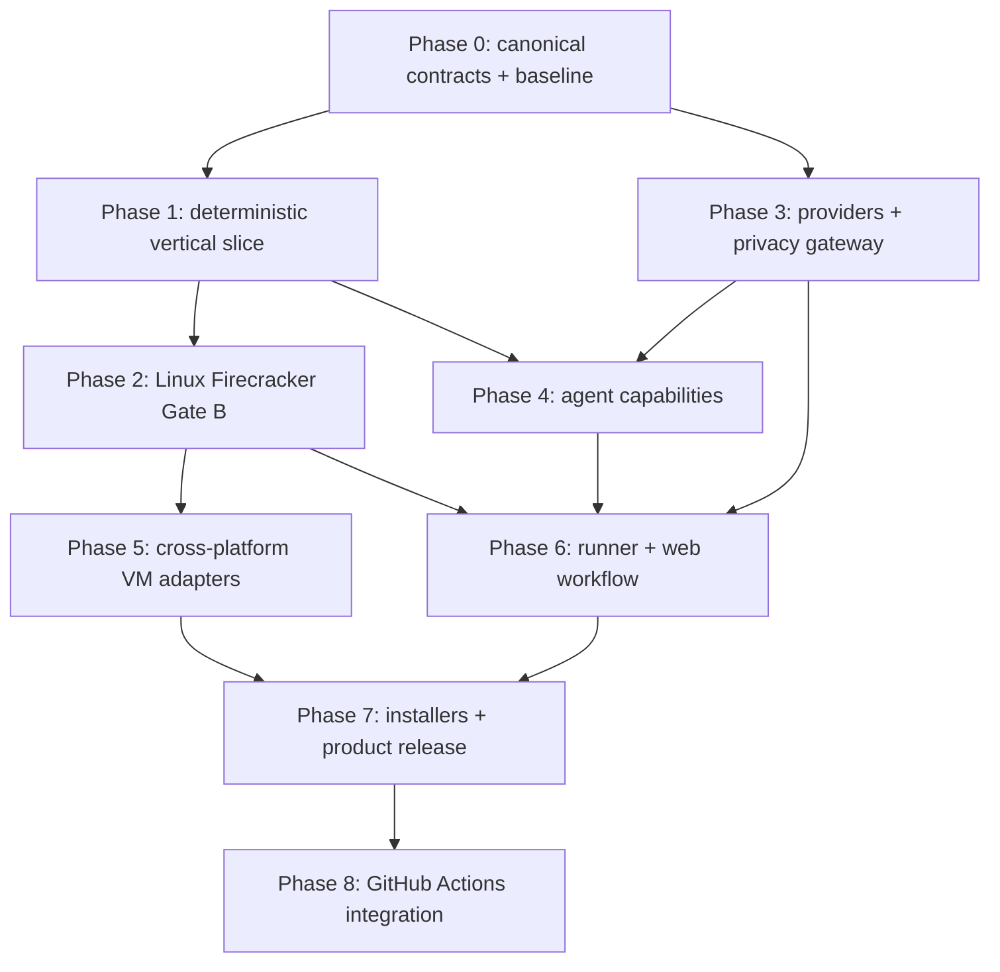

# 07 — Engineering Backlog, Dependencies and Milestones

**Parent:** [Implementation Blueprint](00-master-implementation-plan.md)  
**Purpose:** actionable build order with acceptance criteria, dependency gates and explicit ownership.

## 1. Delivery strategy

Deliver the project in vertical slices. Do not build the whole UI, every provider adapter or all three native VM backends before the first end-to-end execution flow exists.

### Workstream ownership

| Workstream | Primary owner area | Parallelization rule |
|---|---|---|
| A. Contracts and lifecycle | `packages/workflo-schema` | Must land before host, guest, control-plane and dashboard contract work |
| B. CLI / source / config | `apps/workflo-cli` | Can proceed with A's stable schema draft |
| C. Linux host + guest | `worker/`, `apps/worker-engine` | Gate-critical; owns only runtime path |
| D. Control plane / runner | `apps/control-plane`, runner daemon | Can build API client against contract fixtures while C stabilizes protocol |
| E. Provider adapters / privacy | `apps/worker-engine/model`, `apps/control-plane/inference` | Must depend on A and privacy dataflow review; no direct cloud client bypass |
| F. Dashboard / website | `apps/dashboard`, `website` | Begin after stable API/RunSpec; UI shell/visual system may run earlier |
| G. OS backend helpers | Swift VZ helper, C# Hyper-V helper | Platform spikes can run in parallel but cannot declare strict support without gate evidence |
| H. Quality / security | test suites and platform gates | Independent reviewer should own adversarial test coverage where possible |

One engineer may own multiple streams, but the interface contracts and phase gates remain the same. Parallel work must not create independent schemas or competing runtime managers.

## 2. Phase 0 backlog — reconcile and baseline

### WF-0001 — Ratify the canonical contract and trust ADR family

**Priority:** P0 · **Depends on:** none  
**Paths:** `docs/adr/ADR-0015-canonical-contracts-home.md` through `ADR-0021-patch-protocol.md`, `packages/workflo-schema/`, `packages/contracts/`  
**Tasks:**

- Review every proposed ADR-0015…0021 and record an explicit owner decision: ratified, amended-and-ratified, or superseded with a link to its replacement.
- Confirm `packages/workflo-schema` remains the single Python/Pydantic contract-authoring authority and `packages/contracts` remains a validated TypeScript mirror.
- Ratify the existing canonical JSON/evidence-chain, lifecycle/outcome, receipt-v5, policy-admission, event/finding/evidence and patch-protocol decisions as one coherent family; do not create parallel ADR drafts for these topics.
- Confirm accepted ADR-0022 remains the production microVM boundary.
- Export schemas and verify TypeScript parity; inventory duplicate/legacy contract types and name their compatibility owners.

**Acceptance:** each ADR-0015…0021 has a recorded disposition; ADR-0022 remains accepted; schema export and Python/TypeScript golden parity pass; no second authoring source or duplicate decision record remains for new contracts.

### WF-0002 — Establish current baseline

**Priority:** P0 · **Depends on:** none  
**Paths:** `.github/workflows/`, `docs/implementation/BASELINE.md`  
**Tasks:**

- Run active CI workflows on reviewed `main` commit.
- Run Python suites separately and dashboard build.
- Record exact test counts, skipped tests, blocked hardware gates and failures.
- Review existing CI for ignored errors / false greens.
- Separate tests that require KVM from general hosted CI.

**Acceptance:** committed baseline report includes commit, environment, commands, pass/fail/skipped/blocked per suite; no unsupported claim from an older commit is copied as current evidence.

### WF-0003 — Reconcile receipt v5 and legacy verification

**Priority:** P0 · **Depends on:** WF-0001  
**Paths:** `packages/workflo-schema/src/workflo_schema/contracts/receipt.py`, legacy `sandbox.py` receipt, CLI verifier  
**Tasks:**

- Trace all receipt writers and verifier entry points.
- Make v5 DSSE the only new receipt writer.
- Keep v1–v4 verification byte-compatible.
- Define whether v5 has been externally issued; if yes, do not mutate its payload shape.
- Add multi-platform runtime identity fields through an explicitly versioned change.
- Ensure report/CLI distinguishes valid signature from trusted signer and semantic correctness.

**Acceptance:** golden receipts for every supported legacy version plus v5 verify; altered bytes, wrong key, wrong evidence bundle and wrong run binding reject.

### WF-0004 — Inference egress inventory and freeze

**Priority:** P0 · **Depends on:** none  
**Paths:** `packages/sandbox-runtime/`, `apps/workflo-cli/`, `apps/worker-engine/`, `apps/control-plane/`, `workflo-ai-integration/`  
**Tasks:**

- Search all model SDK and HTTP endpoint calls.
- Trace all data passed into each request.
- Mark each path local-only, metadata-only gateway or unsupported.
- Disable direct cloud inference in old planner path.
- Keep local loopback endpoint supported where safe.
- Add temporary tests which fail if a cloud profile sends a direct provider request from CLI/guest.

**Acceptance:** documented egress map; no direct cloud call is reachable from supported cloud profile; regression tests fail if bypass is reintroduced.

### WF-0005 — Runtime ownership and release labels

**Priority:** P0 · **Depends on:** WF-0001  
**Paths:** `PRODUCT_BOUNDARIES.md`, README, CLI doctor/run, `worker/`, `apps/sandbox-executor/`  
**Tasks:**

- Reconfirm one Firecracker manager in `worker/`.
- Label Docker/namespace profiles development-only in CLI, report and receipt.
- Ensure strict run rejects `apps/sandbox-executor` / namespace runtime.
- List which artifacts are production-approved vs still experimental.

**Acceptance:** every runtime reports stable type/profile; tests prove no strict-to-dev fallback.

## 3. Phase 1 backlog — end-to-end deterministic vertical slice

### WF-0101 — Canonical RunSpec and execution plan

**Priority:** P0 · **Depends on:** WF-0001  
**Paths:** `packages/workflo-schema/src/workflo_schema/contracts/`  
**Tasks:** define source, selected checks, app, agent capabilities, resources, network, profile, inference mode and artifact retention. Derive immutable `ResolvedRunPlan` with policy digest and canonical serialization. Validate time and resource ceilings.

**Acceptance:** deterministic digest across Python and exported JSON; illegal/unknown fields rejected; policy cannot be widened by CLI.

### WF-0102 — Source snapshot builder

**Priority:** P0 · **Depends on:** WF-0101  
**Paths:** `apps/workflo-cli/` and reusable package under `packages/`  
**Tasks:** Git exact commit; dirty worktree selection; archive/snapshot builder; path traversal/symlink/device file controls; file count/byte caps; manifest; deterministic digest; source exclusion preview.

**Acceptance:** snapshot is reproducible; host files outside project cannot be read; rejected paths cause no VM launch; snapshot digest matches receipt.

### WF-0103 — Complete guest execution flow

**Priority:** P0 · **Depends on:** WF-0101, WF-0102  
**Paths:** `apps/worker-engine/`, `worker/` guest protocol  
**Tasks:** adapt latest fixed guest slice to receive immutable source snapshot; add declared checks; capture machine-readable test results; app startup/health; shutdown and failure status; no package install script runs on host.

**Acceptance:** `python-fastapi-good` passes, `python-fastapi-broken` yields honest QA fail with verified teardown, app startup failure classified separately.

### WF-0104 — Host evidence collector and finalizer

**Priority:** P0 · **Depends on:** WF-0003, WF-0103  
**Paths:** `worker/`, `packages/workflo-schema/`  
**Tasks:** host-side event spool, bounded frame collection, source trust tags, event sequencing, evidence manifest, result completeness validation, v5 receipt finalization.

**Acceptance:** guest cannot modify host evidence store; evidence swap/tampering rejected; missing test results cannot produce passing QA.

### WF-0105 — CLI end-to-end command

**Priority:** P0 · **Depends on:** WF-0101–0104  
**Paths:** `apps/workflo-cli/`  
**Tasks:** unify init/doctor/run/status/inspect/explain/verify around canonical RunSpec/receipt. Keep existing flags. Report execution/QA/trust separately.

**Acceptance:** fresh venv install, run known pass/fail fixture, offline verify; exact source/policy binding visible.

### WF-0106 — Prototype demo fixture suite

**Priority:** P0 · **Depends on:** WF-0102–0105  
**Paths:** fixture repositories and E2E tests  
**Tasks:** create fixture set from `06-testing-and-acceptance.md`; pin commits; make one deterministic demo script; make artifacts retained by CI.

**Acceptance:** reproducible run from clean checkout; demo does not need a live model/provider.

## 4. Phase 2 backlog — Linux strict backend / Gate B

### WF-0201 — Real host resource scope

**Priority:** P0 security blocker · **Depends on:** WF-0005  
**Paths:** `worker/src/workflo_worker_host/manager.py`, admission, provision scripts  
**Tasks:** create per-attempt cgroup hierarchy for VMM/guest descendants; apply CPU/memory/PID/I/O limits before untrusted workload; enforce startup failure when any required limit cannot be attached; record actual values; test cgroup removal.

**Acceptance:** real KVM run demonstrates limits under load; cgroup attachment failure blocks provisioning; teardown proves scope empty/removed.

### WF-0202 — Enforced egress network backend

**Priority:** P0 security blocker · **Depends on:** WF-0201  
**Paths:** `worker/src/workflo_worker_host/network.py`, firewall scripts  
**Tasks:** implement per-run default-deny network namespace or equivalent egress policy; scoped proxy; DNS/IP/redirect validation; deny metadata/private/host routes; clean ruleset at teardown.

**Acceptance:** real guest cannot reach external/private/meta targets; permitted internal app route works; failed ruleset apply blocks VM start; removal is independently verified.

### WF-0203 — Jailer, seccomp and filesystem admission

**Priority:** P0 · **Depends on:** WF-0201  
**Paths:** `worker/`, guest image build  
**Tasks:** verify pinned Firecracker/jailer; harden UID/GID/chroot; seccomp profile; no host mount; immutable source/rootfs; disk size/format limits; guest user drop; image signing and manifest.

**Acceptance:** actual host launch config matches receipt; prohibited host files/devices inaccessible; unpinned binaries/images block admission.

### WF-0204 — Independent teardown inventory and crash recovery

**Priority:** P0 · **Depends on:** WF-0201–0203  
**Paths:** `worker/`, supervisor and runner daemon  
**Tasks:** inventory every created resource (VMM, cgroups, tap/veth/netns, nftables table, disk, vsock, sockets, temp dirs, capability); manager restart recovery; process group termination; resource removal and probes.

**Acceptance:** inject host/worker crash and stuck guest; recovery finds and terminates resources; all eight receipt checks grounded in actual resources; missing probe never passes.

### WF-0205 — Gate B adversarial test harness

**Priority:** P0 · **Depends on:** WF-0201–0204  
**Paths:** `worker/tests/integration/`, `.github/workflows/linux-gate.yml`  
**Tasks:** real KVM boot, host escape attempts, network deny, cross-VM isolation, CPU/memory/disk/PID exhaustion, force kill, cleanup, gateway outage. Store exact evidence.

**Acceptance:** protected real-KVM run passes all mandatory cases on exact commit; no mocked boot or skipped test counts as Gate B.

## 5. Phase 3 backlog — model registry and privacy gateway

### WF-0301 — Provider/profile schemas

**Priority:** P1 · **Depends on:** WF-0001  
**Tasks:** profile, endpoint class, privacy mode, credentials reference, capability negotiation, limits and model identity schema; project/org policy precedence.

**Acceptance:** cloud+source policy rejected; unknown profile fields rejected; credential bytes absent from schema/output.

### WF-0302 — Adapter interface and local provider support

**Priority:** P1 · **Depends on:** WF-0301  
**Tasks:** migrate pinned llama.cpp/GGUF; add generic OpenAI-compatible local endpoint; add Ollama and LM Studio adapter; health/model list and test calls; loopback/private endpoint policy.

**Acceptance:** local provider contract suite passes; no network/cloud fallback on local endpoint failure.

### WF-0303 — Cloud gateway provider adapters

**Priority:** P1 · **Depends on:** WF-0301, WF-0004  
**Tasks:** provider registry on control plane; OpenAI, Anthropic, Gemini, OpenRouter adapters; safe generic adapter; tenant vault resolver; bounded retries/stream handling; normalize plan response.

**Acceptance:** all provider adapter contract tests pass; no direct cloud endpoint path from CLI or guest.

### WF-0304 — Positive allowlist cloud payload schema

**Priority:** P0 privacy blocker · **Depends on:** WF-0301  
**Tasks:** replace free-form cloud observation fields with typed status/route/metric/error enums; separate user mission; cap byte/count size; ban source-bearing tool and prompt field.

**Acceptance:** source and fake-secret canaries absent from captured request/headers/telemetry; unknown fields are rejected before outbound request.

### WF-0305 — Credential vault and config migration

**Priority:** P1 · **Depends on:** WF-0302, WF-0303  
**Tasks:** OS vault for local keys, control-plane encrypted tenant vault for BYOK, no argv secret, migrate old `llm_config`, remove unsafe file key fallback or restrict to explicitly development profile.

**Acceptance:** filesystem/log/process/environment/browser inspections show no key bytes; vault rotation/revoke test works.

### WF-0306 — Provider test UI and CLI

**Priority:** P2 · **Depends on:** WF-0302–0305  
**Tasks:** provider add/update/test/use/list/remove; dashboard Settings; clear endpoint class and privacy mode display; never display credential.

**Acceptance:** CLI and web settings produce same ProviderProfile; server enforces privacy regardless of UI client.

## 6. Phase 4 backlog — full agent

### WF-0401 — Tool schema and capability registry

**Priority:** P0 agent security · **Depends on:** WF-0101, WF-0304  
**Tasks:** canonical definitions for repo metadata, test run, app start/health, API, browser, log summary, analysis and advisory patch. Validate each tool input/output, policy capability, byte/time limits.

**Acceptance:** unknown and unauthorized tool plans rejected; no arbitrary shell tool exists.

### WF-0402 — Deterministic test/app/API tools

**Priority:** P1 · **Depends on:** WF-0103, WF-0401  
**Tasks:** test selectors, app lifecycle and health checks, HTTP client scoped to guest app, structured summaries, safe body assertion rules.

**Acceptance:** pass/fail/timeout/connection refusal states accurately recorded.

### WF-0403 — Playwright browser tool

**Priority:** P1 · **Depends on:** WF-0401  
**Tasks:** browser guest image, app-origin allowlist, Playwright actions, downloads quarantine, screenshot artifact policy, structured output.

**Acceptance:** fixture login/checkout works, external navigation blocked, browser context has no host profile/cookies.

### WF-0404 — Log summarizer and failure analyzer

**Priority:** P1 · **Depends on:** WF-0401, WF-0304  
**Tasks:** collect logs within byte/time limits, parse structured error codes, redaction, map to evidence-linked findings, classify unknowns.

**Acceptance:** cloud receives only safe error class and summary metrics; local mode may access selected logs; findings link to exact source evidence.

### WF-0405 — Agent orchestrator / planner loop

**Priority:** P1 · **Depends on:** WF-0302/0303, WF-0401–0404  
**Tasks:** batch planning, budgets, plan validation, deduplication, retry bounds, progress, action result feedback; planner never executes tool itself.

**Acceptance:** known fixture missions complete within budget; policy violation is denied and recorded; malformed response doesn't execute partial unsafe plan.

### WF-0406 — Advisory patch generator

**Priority:** P2 · **Depends on:** WF-0404, local model capability  
**Tasks:** source-aware local patch generation; cloud mode can offer high-level non-source suggestion only; patch validation against safe temp copy; output/download.

**Acceptance:** original working tree unchanged; patch path safe; patch digest and “not yet validated” label shown.

### WF-0407 — Agent evaluation suite

**Priority:** P1 · **Depends on:** WF-0405  
**Tasks:** known missions, expected routes, allowed tool plans, failure case labels, prompt injection tests, plan quality metrics.

**Acceptance:** report tool plan accuracy and violations across fixed evaluation set; no ungrounded product accuracy claims.

## 7. Phase 5 backlog — macOS/Windows and packaging

### WF-0501 — Shared backend interface / host broker

**Priority:** P1 · **Depends on:** WF-0204  
**Tasks:** finalize Python `SandboxBackend` protocol; transport contract; error taxonomy; platform capability/admission schema. Do not generalize away Firecracker-specific operations that cannot be portable.

**Acceptance:** Linux backend implements protocol; contract tests run in-process; protocol version locked.

### WF-0502 — macOS Virtualization.framework spike

**Priority:** P1 technical spike · **Depends on:** WF-0501  
**Tasks:** Swift helper; entitlement/signing model; real Linux VM boot; transport POC; ephemeral disk; network isolation; helper IPC.

**Acceptance:** design reviewed with a real boot and evidence for every host control; if a required property cannot be proved, mark unsupported rather than claim completion.

### WF-0503 — Windows Hyper-V spike

**Priority:** P1 technical spike · **Depends on:** WF-0501  
**Tasks:** C#/.NET helper; supported Windows edition check; real Linux VM boot; VMBus/Hyper-V Socket transport; isolated virtual switch; disk lifecycle; forced stop and resource probes.

**Acceptance:** real Hyper-V VM with authenticated typed protocol; Windows Home explicitly routes to remote runner if unsupported.

### WF-0504 — Platform gate suites

**Priority:** P0 for strict OS claims · **Depends on:** WF-0502/0503  
**Tasks:** implement platform-specific adversarial and cleanup tests, run on actual Macs and Windows Hyper-V hosts.

**Acceptance:** Gate report signed/retained for each OS and architecture. UI only labels strict-ready when gate version passes and matches installed runtime.

### WF-0505 — Installers and signed updates

**Priority:** P1 · **Depends on:** WF-0501–0504  
**Tasks:** CLI wheels, signed native helpers, guest image manifest, Linux/macOS/Windows installer, upgrade/rollback/uninstall, release SBOM/provenance.

**Acceptance:** fresh host install and update verified; artifact tampering rejected; active run not disrupted by update.

## 8. Phase 6 backlog — Dashboard and control plane

### WF-0601 — Runner enrollment and heartbeat

**Priority:** P1 · **Depends on:** WF-0101, WF-0501  
**Tasks:** pair code, keypair, enrol, signed heartbeat, runner capability report, revocation, leasing/fencing.

**Acceptance:** untrusted or revoked runner cannot claim assignment; stale lease cannot create parallel attempt writes.

### WF-0602 — Run dispatch integration

**Priority:** P1 · **Depends on:** WF-0101, WF-0601  
**Tasks:** dispatch through durable PG outbox; assignment signature; claim; event/evidence upload; completion; runner loss/recovery.

**Acceptance:** real PostgreSQL transaction and runner integration; no in-memory production queue; idempotency tested.

### WF-0603 — Dashboard shell and identity

**Priority:** P1 · **Depends on:** control-plane auth APIs  
**Tasks:** rebrand `apps/dashboard`, auth/session, workspaces, project settings, permissions.

**Acceptance:** workspace/tenant isolation tests and API error/loading/empty states.

### WF-0604 — Provider settings and runner UI

**Priority:** P2 · **Depends on:** WF-0306, WF-0601  
**Tasks:** profile UI, credential replace, privacy display, runner pairing/status and backend eligibility.

**Acceptance:** same schemas as CLI; secret not returned/rendered; strict eligibility not editable by browser.

### WF-0605 — Run creation, timeline and reports

**Priority:** P1 · **Depends on:** WF-0602  
**Tasks:** create run, event SSE, safe cancellation, report and receipt/evidence browser.

**Acceptance:** dashboard creates actual local runner execution; stream reconnect correct; result labels match CLI and offline verifier.

### WF-0606 — Website installation and docs

**Priority:** P2 · **Depends on:** WF-0505  
**Tasks:** OS install tabs, signatures/checksums, support matrix, quick start, links to app/docs.

**Acceptance:** install commands verified on clean OS; docs don't call unproven backend strict.

## 9. Phase 7/8 backlog — release and CI

### WF-0701 — Fresh-machine release acceptance

- Test latest CLI/runner package on clean Linux, macOS and Windows host.
- Confirm provider config, source snapshot, one successful/one failing project and offline receipt verification.
- Capture install/update/uninstall logs and checksums.

### WF-0702 — Security/provenance release bundle

- Generate SBOM and build provenance.
- Sign CLI/helper/guest images and receipt public-key metadata.
- Publish immutable image digests and verification instructions.
- Independent verifier job has no producer-side secrets.

### WF-0801 — GitHub Actions integration

- Wrapper uses published CLI and same RunSpec.
- Runner/host availability policy explicit.
- Artifact upload and receipt verify.
- Action failure status separates failed project check from Workflo infrastructure issue.
- No automatic merges/deployments.

**Acceptance:** a CLI local run and GitHub Actions run against same commit/policy use identical receipt semantics and the same verifier.

## 10. Milestone dependency graph

Phases 3 and 4 may overlap with the Linux Gate B work if their contracts are stable, but a public release with cloud agent mode requires both the relevant isolation gate and privacy gate. Phase 5 OS implementations can be developed in parallel but cannot be called done until each passes its host-specific acceptance.

## 11. Review cadence and definition of done

For each PR:

- linked work item and phase/gate;
- exact target contract/version;
- paths changed and why;
- tests run and evidence links;
- explicit non-goals / limitations;
- no unrelated refactor;
- no new bypass or development fallback;
- update relevant README/docs/status/ADR;
- reviewer signs off on security boundary when relevant.

A capability is complete only when code, tests, docs, telemetry, error handling and acceptance evidence are all present. A PR merged into `main` is not proof of production readiness.