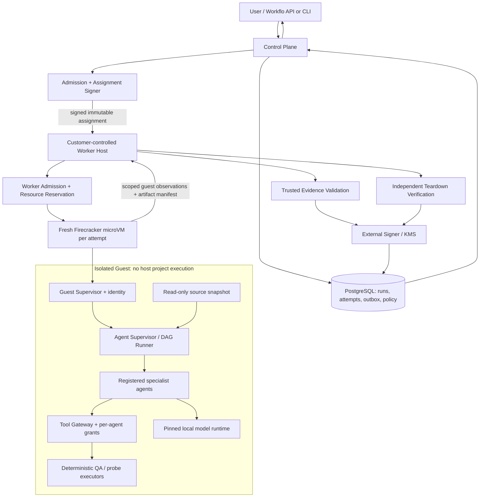

# Workflo Agentic Execution Phase — Implementation Plan v1

**Status:** Draft for owner review  
**Target baseline:** `main` at `5ffb6678756b4d0c189d9461d0b603a154aadd17`  
**Scope:** Production-grade agent execution inside per-attempt Firecracker/KVM microVMs  
**Plan owner:** Workflo engineering  
**Release posture:** Design and development work may proceed on development runtimes; production agent execution remains blocked until Gate B and the relevant model/evidence gates pass.

---

## 1. Executive intent

The Agentic Execution Phase turns Workflo from a system that primarily runs declared QA checks and a bounded single-agent exploration loop into a **policy-governed execution platform for specialized agents**.

A user submits an exact-revision QA mission. Workflo admits it against an immutable policy bundle, dispatches a signed assignment to an eligible customer-controlled worker, provisions one fresh Firecracker microVM for the attempt, starts the approved guest runtime, and launches the authorized agent workload inside that guest. Agents use only registered tools and capabilities. Their proposals and observations are recorded, deterministic checks decide what can become a verified finding, and the trusted host validates evidence, independently verifies teardown, and signs the final receipt outside the guest.

The system must preserve this distinction:

- **Agent output is a proposal or observation.** It is never trusted as a lifecycle transition, security verdict, teardown proof, or receipt.
- **The sandbox is the execution boundary.** No customer project code, agent tool, or source-bearing inference runs on the control-plane host.
- **The host is the authority boundary.** Admission, worker eligibility, lifecycle transitions, policy enforcement, evidence validation, teardown verification, and signing remain trusted-host responsibilities.

### Outcome we are building

A complete, repeatable end-to-end workflow:

1. Pin a repository, commit, and source snapshot.
2. Admit a versioned policy and a registered agent profile.
3. Dispatch one immutable assignment to a customer-controlled worker.
4. Boot a fresh, digest-pinned Firecracker microVM.
5. Verify guest identity over the narrow vsock protocol.
6. Launch the approved Workflo agent runtime and local model inside the guest.
7. Explore the project with bounded specialist roles and governed tools.
8. Run deterministic tests and probes; classify model-generated ideas as candidates until independently verified.
9. Collect and validate scoped evidence.
10. Terminate the VM, independently verify resource removal, and issue a signed receipt.

This is an execution platform, not an unrestricted “AI shell.” An agent may reason about a task and propose actions, but only the admitted tool gateway and deterministic execution stages can perform them.

---

## 2. Repository baseline and implementation gaps

This plan extends the existing Workflo lineage. It does not introduce another product, another control plane, a second Firecracker implementation, or a parallel queue.

### Existing components to build on

| Area | Existing home | Current foundation |
|---|---|---|
| Durable admission and dispatch | `apps/control-plane` | PostgreSQL run/attempt/outbox transaction, worker leases, heartbeats, retry classification, cancellation path |
| Canonical contracts | `packages/workflo-schema` | Versioned lifecycle, policy, event, finding, evidence, receipt, and patch contracts |
| MicroVM host | `worker/` | `SandboxAssignmentV1`, host eligibility probing, typed manager operations, VM config/jailer argv construction, default-deny nftables rules, teardown verification seam |
| Guest/host protocol | `worker/src/workflo_worker_host/protocol.py` | Versioned messages, attempt/sandbox binding, monotonic sequences, payload digests, size limits, unknown-message rejection |
| Guest supervisor | `worker/src/workflo_worker_host/guest_supervisor.py` | Guest identity/capability, ready signal, heartbeat, cancellation/shutdown handling, guest evidence manifest |
| Agent runtime | `apps/worker-engine` | In-sandbox agent runner, tool gateway, structured observations, bounded tool-call records |
| Agent role taxonomy | `packages/sandbox-runtime/src/sandbox_runtime/orchestrator.py` | Provisioner, Ingestor, Executor, Explorer, Judge, Notary role/stage map |
| Existing development orchestration | `packages/sandbox-runtime`, `supervisor/` | Development-only namespace lifecycle, mission state, planner, deterministic judge, inference scheduler |
| Local model serving | `workflo-ai-integration/`, `apps/worker-engine` | llama.cpp/GGUF router and validation path; release artifact and protected model acceptance still require real evidence |
| Evidence and receipts | `packages/sandbox-isolation`, `packages/workflo-schema` | Evidence binding, dev proof bundle, receipt verification, teardown records |

### Gaps that drive the sequence

1. **No production Firecracker client has been located.** The host manager currently depends on the `FirecrackerClient` protocol seam; manager tests use a fake. A production jailer/VMM adapter and real vsock transport must be implemented.
2. **The current KVM test is not a boot test.** It probes for Linux/KVM and checks reported tooling when present; it skips when KVM or release artifacts are missing. It does not prove boot, guest execution, host isolation, or teardown.
3. **The control-plane dispatch path still constructs `SandboxExecutor`.** The durable outbox is valuable and must be retained, but production dispatch must route to authenticated microVM workers instead of treating the Docker executor as the customer execution path.
4. **The guest supervisor is not yet connected end to end.** The protocol/model exists, but the production vsock transport, guest boot integration, capability delivery, and worker lifecycle need integration proof.
5. **The existing agent loop is bounded but narrow.** `agent_runner.py` and `ToolGateway` support task-spec/planner operation and five tools. A versioned agent profile, typed mission plan, role-scoped grants, and policy-bound budgets are still needed.
6. **The development planner can run on the host.** That observation-only path is useful for development, but it must not become the production source-bearing inference path. The adopted baseline says project-aware agents and inference run inside the guest by default.
7. **Real model acceptance remains separate from code completion.** A mocked router or passing unit suite is not proof of the pinned GGUF/image path or protected staging acceptance.
8. **Teardown must be proven against the real microVM resources.** Fake-client tests and namespace teardown evidence do not prove Firecracker process, jailer cgroup, tap/network namespace, vsock socket, scratch disk, and guest resource removal.

Docker, bubblewrap, and Linux namespace runtimes remain development/CI profiles only. A missing KVM device, missing pinned binary/image, unavailable vsock, failed network rule application, or failed teardown check must never trigger a Docker/bwrap fallback for a production run.

---

## 3. Architecture and trust boundaries

### 3.1 Target topology

**Trust boundary rule:** the guest may produce observations and artifacts; the host validates them. The host may control the VM lifecycle; it must never accept a guest request to execute an arbitrary host operation. Only the trusted signer can issue the final receipt, after evidence validation and teardown verification.

### 3.2 Responsibility split

**Control plane — trusted orchestration authority**
- Authenticate the caller and resolve tenant/project identity.
- Validate the run request and resolve the immutable execution policy.
- Resolve approved agent profiles and model/runtime identities.
- Persist run, attempt, and dispatch intent atomically in PostgreSQL.
- Issue signed, attempt-bound assignments and short-lived worker claims.
- Own lifecycle transitions, retries, cancellation intent, audit, and receipt references.
- Never execute repository code, agent tools, or source-bearing inference.

**Worker host — trusted infrastructure boundary**
- Advertise honest capabilities and remain ineligible unless all required runtime, image, capacity, and health checks pass.
- Verify assignment signature, scope, digest, policy binding, and expiry.
- Reserve resources before provisioning.
- Apply the per-attempt host network policy before the VM starts.
- Provision and monitor the pinned Firecracker process through jailer.
- Deliver only a narrow, expiring run capability over the authenticated guest channel.
- Collect host-observed lifecycle evidence, terminate, and independently verify cleanup.
- Never expose a host shell, Docker socket, arbitrary filesystem API, or generic guest-to-host RPC.

**Guest supervisor — untrusted execution-side lifecycle participant**
- Boot first and prove attempt/sandbox identity before project work starts.
- Receive the immutable task envelope and capability grant.
- Start only the approved guest runtime and agent profile digests.
- Send sequence-bound heartbeats, structured observations, and an evidence manifest.
- Stop starting new work on cancellation, budget exhaustion, or shutdown.
- Never determine final lifecycle state, trust outcome, or receipt validity.

**Agent runtime — untrusted, capability constrained**
- Build and execute a typed task DAG from an admitted mission.
- Run specialist agents with separate role identity, tool grants, context scope, and budgets.
- Treat repository content, issue descriptions, logs, web pages, and model output as untrusted data.
- Return action proposals and bounded observations through the Tool Gateway.
- Never sign, alter policy, grant itself tools, widen network access, or mark its own finding as verified.

**Evidence service / signer — trusted result authority**
- Validate artifact digests, scope, event sequences, policy/runtime provenance, and evidence completeness.
- Treat guest event records as claims until independently validated.
- Derive deterministic findings from reproducible checks.
- Independently verify teardown.
- Sign only after all required validation succeeds; signer keys remain outside the guest.

### 3.3 Agent deployment model

For the first release, **agents are deployed as approved runtime profiles inside the guest image**, not as arbitrary user-supplied containers or plugins.

Each registered profile is immutable and digest-pinned. A profile contains:
- profile ID, semantic version, runtime bundle digest, entrypoint, and compatibility range;
- role identity and allowed task types;
- input/output JSON Schemas;
- model profile and permitted inference mode;
- explicit tool IDs and argument schemas;
- allowed source/workspace paths and artifact classes;
- network policy reference (default deny);
- per-task token, call, wall-clock, output-size, and retry ceilings;
- allowed dependent roles and event types;
- provenance and approval status.

The assignment binds the exact profile version and bundle digest. The worker refuses unknown, revoked, unsigned, mutable-tag, or digest-mismatched runtime bundles.

**Do not support arbitrary third-party agent images in the MVP.** A later extension may accept customer-supplied agent bundles only after signing, provenance, static validation, capability review, and isolated admission have been designed and tested.

---

## 4. Agent model and first supported workflow

### 4.1 Role model

Retain the repository's role separation as the starting point: Provisioner, Ingestor, Executor, Explorer, Judge, and Notary. Do not turn these into six privileged autonomous agents.

| Role | Execution location | Authority |
|---|---|---|
| Provisioner | Trusted worker host | Provision/terminate the VM through typed host operations only |
| Ingestor | Guest | Acquire and snapshot the exact source revision using scoped source-fetch capability |
| Executor | Guest | Run fixed, policy-approved test/probe workloads |
| Explorer | Guest | Model-assisted exploration through the Tool Gateway; only this role uses the model in the initial workflow |
| Judge | Guest/trusted verifier split | Guest may propose candidate findings; trusted deterministic verifier alone stamps verified failures |
| Notary | Trusted host | Validate evidence, verify teardown, prepare receipt payload, request external signing |

The initial implementation is intentionally **single mission supervisor with sequential specialist stages**. Role-level event and capability boundaries are established first. Bounded parallel agents are a later increment after cancellation, quotas, evidence attribution, and resource accounting are stable.

### 4.2 First production workflow

Ship one narrow workflow before general-purpose agent orchestration:

**Repository QA exploration for an exact commit**
1. Ingestor verifies and snapshots the exact repository revision.
2. Deterministic Executor runs the declared baseline suite and starts the application only when the admitted profile requests it.
3. Explorer reads only approved source paths and/or exercises approved application routes through Tool Gateway.
4. Explorer may propose additional test cases and suspicious behaviors as structured candidates.
5. Test Designer validates generated test proposals against schema, path, size, import, AST, compile, and policy gates. It cannot write outside the generated-test area.
6. Executor runs only accepted generated tests in the same attempt, with an explicit test-run budget.
7. Judge correlates candidate observations with deterministic reproductions. Only repeatable, evidence-backed failures become `verified_failure`; otherwise they remain candidate/inconclusive.
8. Notary validates the artifact manifest and event ledger, verifies teardown, and signs the receipt outside the guest.

**MVP non-goals:** autonomous code repair, direct patch application, Git push, pull-request creation, merge, deployment, production credential access, unbounded browser access, arbitrary shell tools, self-modifying agents, and agents creating or modifying other agents. The existing patch protocol is for a later separately approved phase; this phase may produce suggestions only.

### 4.3 Mission plan and DAG contract

The model may propose a plan, but a deterministic validator compiles it into an executable DAG. The plan must be typed and bounded before any step runs.

Each task node contains:
- `task_id`, `run_id`, `attempt_id`, `profile_id` and exact profile digest;
- role, purpose, bounded input references, and expected output schema;
- predecessor IDs and dependency conditions;
- permitted tool IDs, scoped paths, and capability reference;
- resource, token, tool-call, wall-clock, output, and retry budgets;
- idempotency key and cancellation behavior.

The compiler rejects unknown roles/tools, cycles, missing dependencies, scope escalation, invalid paths, unsupported model profiles, excessive fan-out, budget overflow, and any requested policy mutation.

Agent-to-agent coordination uses typed messages and immutable artifact references. Agents do not receive unrestricted access to another agent's private working state. There is no shared cross-run workspace. The first release executes roles sequentially; a later release may allow bounded DAG parallelism with per-node budgets.

---

## 5. Sandbox lifecycle — required execution sequence

The following order is mandatory. Any failed step stops progression and produces an explicit infrastructure/trust outcome.

| Step | Operation | Required invariant |
|---|---|---|
| 1. Request | Authenticate caller; pin repository, commit, project, requested profile | Tenant and repository scope resolved; idempotency enforced |
| 2. Admission | Resolve and validate the immutable 12-component policy bundle | Policy digest recomputed; no agent-editable policy values |
| 3. Profile resolution | Resolve agent runtime, profile, tool registry, model, guest image by digest | All artifacts approved, pinned, compatible, and non-revoked |
| 4. Durable dispatch | Persist run + attempt + outbox in one PostgreSQL transaction | No in-memory queue as authority; retry creates a new attempt and new sandbox |
| 5. Worker claim | Authenticated worker claims a lease and verifies assignment | Worker identity, lease, tenant, attempt, expiry, and policy digest match |
| 6. Host admission | Probe KVM, pinned Firecracker/jailer, image allowlist, capacity, disk, and host health | Any missing capability makes worker ineligible; never fall back |
| 7. Resource reservation | Atomically reserve vCPU, memory, disk, process, and concurrency quota | No overcommit beyond configured safety margin; reservation is released only after teardown |
| 8. Network setup | Create per-sandbox network scope and apply nftables rules | Default deny; metadata/private/loopback escape paths blocked; rule failure means no VM |
| 9. VM provision | Create fresh scratch disk, configure read-only rootfs, launch pinned Firecracker through jailer | New VM per attempt; no host project code; no reused writable disk |
| 10. Guest handshake | Guest supervisor sends first `GUEST_READY` over vsock | Attempt/sandbox binding, protocol version, identity, sequence, nonce, and payload digest verified |
| 11. Capability delivery | Host delivers minimal short-lived run capability and immutable task envelope | No ambient environment secrets; no generic host operations; replay prevented |
| 12. Source/model staging | Guest acquires source snapshot and loads approved local model/runtime | Source-bearing inference stays inside guest; source snapshot is read-only; model/runtime digests match |
| 13. Agent execution | Guest starts mission supervisor and approved agent tasks | Every tool invocation is checked and recorded; agent cannot widen policy or budgets |
| 14. Monitoring | Host checks heartbeat, lease, resource use, wall-clock, and protocol state | Lease loss, heartbeat expiry, resource breach, or protocol violation triggers cancellation/termination |
| 15. Output collection | Guest emits bounded manifest and artifact references; host ingests to quarantine | Validate digest, type, size, classification, tenant/run/attempt scope before promotion |
| 16. Judgment | Trusted verifier recomputes deterministic checks and finding criteria | Model output remains candidate-only; infrastructure errors are not product defects |
| 17. Teardown | Graceful shutdown, then force terminate at deadline; remove VM/network/disk/process resources | Independent host probes; any unperformable check fails closed |
| 18. Receipt | Validate event ledger/evidence and teardown; sign from external signer | Receipt binds exact source, policy, guest/runtime, model, tools, evidence root, and teardown result |
| 19. Finalize | Persist separate execution, QA, and trust outcomes; publish status | A QA pass is not a trust pass; no receipt when required trust checks fail |

Cancellation is a request, not proof. The host must stop accepting new work, notify the guest, enforce the shutdown deadline, force terminate if needed, and report teardown honestly.

---

## 6. Security and isolation requirements

### 6.1 Host and hypervisor boundary

- One Firecracker microVM per run attempt; no multi-tenant guest sharing in the MVP.
- Pinned Firecracker and jailer binaries, verified by version and immutable artifact digest.
- Firecracker launched only through jailer with dedicated UID/GID, chroot, seccomp, cgroup, namespace, and resource limits.
- No host project checkout, no host execution of repository scripts, no Docker socket, no host bind mount of guest state, and no host-shell operation exposed to the guest.
- Guest rootfs and agent runtime are read-only. Writable scratch storage is fresh, bounded, attempt-specific, and destroyed after use.
- Resource enforcement must cover vCPU, memory, disk, process count, open files, wall-clock, output bytes, log bytes, and concurrent guests.
- Worker capacity is reserved before VM start and released only after verified teardown.

### 6.2 Guest and agent boundary

- Guest supervisor verifies identity before project work.
- Agent process runs unprivileged; do not run the model or agent loop as guest root.
- Separate agent process identity and tool grants by role where technically practical; no direct arbitrary process-to-process control channel.
- No generic unrestricted shell tool. Add narrow typed tools for repository reads, test proposal, approved test execution, app HTTP probe, log read, and evidence reference creation.
- File access uses canonicalized paths, rejects symlink escape and traversal, and limits file count, depth, bytes, and content class.
- The Tool Gateway validates tool ID, exact schema, granted capability, path scope, network policy, budget, rate limit, idempotency, and cancellation state before invocation.
- Every allowed and denied attempt is recorded with bounded/redacted arguments, result digest, status, sequence, duration, and agent/profile identity.
- Tool outputs, repo content, comments, logs, web content, and model-generated strings are always untrusted data, never policy instructions.
- Do not persist chain-of-thought. Persist concise action intent, tool call, observable facts, result digest, and bounded rationale only.

### 6.3 Network and credential boundary

- Guest egress is default deny. Do not rely on DNS filtering alone.
- Block cloud metadata, link-local, RFC1918/private, CGNAT, multicast, host gateway, and worker control-plane internals unless a separately reviewed exact endpoint is required.
- Resolve allowed hostnames to pinned IP literals before assignment; guard redirects, DNS rebinding, IPv4/IPv6 variants, and proxy bypass.
- Initial QA profile permits only loopback/in-guest services and explicitly admitted internal app endpoints.
- Source acquisition and model access use narrow, purpose-bound gateways or guest-local services. No general internet access.
- Secrets never enter prompts, task plans, agent-visible environment variables, logs, artifacts, or evidence bundles.
- External credentials, where a later profile requires them, are short-lived, scoped, and mediated by a trusted broker; the agent never receives a reusable project-wide secret.
- A required gateway outage or inability to enforce the egress policy fails closed.

### 6.4 Threat cases and expected control

| Threat | Required control / test |
|---|---|
| Malicious repository prompt injection | Explicit data/instruction separation; injected README/test/log content cannot change system policy, tools, or task scope |
| Agent asks for forbidden tool | Gateway denies and records; no side effect occurs |
| Path traversal / symlink escape | Canonical path validation and adversarial fixtures; access outside approved roots denied |
| SSRF / metadata access / DNS rebinding | IP-level default deny, redirect revalidation, reserved-range blocks, egress canaries |
| Guest attempts host access | Negative host filesystem, process, socket, metadata, and control-plane access tests |
| Cross-tenant or cross-run artifact substitution | Scope validator rejects every mismatched org/project/run/attempt/sandbox reference |
| Forged/replayed guest messages | Signature/capability binding, attempt binding, monotonic sequence, nonce/expiry, payload digest |
| Resource exhaustion | Enforced vCPU/memory/disk/process/time/token/tool/output ceilings and worker quotas |
| Agent/model exfiltration | Source-bearing inference in guest; egress policy; no external source prompt; secret redaction |
| Worker crash / host restart | Durable lease recovery; attempt becomes infrastructure/incomplete; new attempt receives a new VM |
| Teardown concealment | Host-observed independent probes; guest self-report is never accepted as cleanup proof |
| Mutable/revoked agent image | Registry allowlist, immutable digest, revocation check at admission and worker boot |

---

## 7. Contracts and persistence changes

Do not break the frozen `/v1` API, legacy database enums, or receipt v1–v4 verification. New agentic contracts are additive and versioned.

### Proposed contract set

1. **`AgentProfileV1`** — immutable profile metadata, runtime digest, role, model/tool IDs, resource ceilings, IO schemas, provenance, approval/revocation status.
2. **`AgenticMissionV1`** — user mission, exact source revision, selected approved profiles, bounded run-level budgets, policy reference.
3. **`AgentPlanV1`** — typed DAG, dependencies, max nodes/fan-out, validator version, compiled plan digest.
4. **`AgentTaskV1`** — one role invocation, task identity, input refs, capability grant, exact profile digest, output contract, budgets, idempotency key.
5. **`AgentCapabilityGrantV1`** — allowed tool IDs, path scopes, endpoint scopes, expiry, per-tool limits, attempt/sandbox binding.
6. **`AgentActionEventV1`** — propose/validate/deny/execute/observe events; no chain-of-thought fields; guest producer is observation-only.
7. **`AgentExecutionRecordV1`** — profile/model/tool digests, start/end, resource consumption, call counts, status, failure class.
8. **`AgentArtifactRefV1`** — scoped immutable reference to generated tests, reports, or other bounded outputs.
9. **`AgentBudgetV1`** — max tokens, inference requests, tool calls, parallel tasks, elapsed time, CPU/memory/disk, output/log bytes, retry count.

### Assignment evolution

Keep `SandboxAssignmentV1` immutable for existing callers. Introduce a versioned successor only when the new fields are agreed and schema-export parity is in place. The successor must bind at least:
- policy digest and exact run/attempt/sandbox identity;
- guest kernel/rootfs and base runtime image digests;
- agent profile registry snapshot digest and selected profile bundle digests;
- tool registry digest and capability grant digest;
- model ID, image/artifact digest, adapter manifest digest, inference mode;
- resource, network, artifact, retention, and teardown policy;
- expiry, issuer/key ID, and authenticated assignment digest.

Persist agent plans, task nodes, state transitions, agent events, action records, evidence metadata, and receipt references in the canonical PostgreSQL authority. Object storage holds immutable artifact bytes only; it does not become a second lifecycle or policy authority. Apply tenant RLS to every new tenant-owned table and test with a non-owner/non-superuser application role.

### Event and finding semantics

- Only trusted-control producers drive lifecycle transitions.
- Guest/agent events are observations and must be validated before a state consequence.
- The model may create `candidate` or `inconclusive` findings.
- Only deterministic reproduction/verification may create `verified_failure`.
- `infrastructure_failure` never counts as a product defect; `not_tested` is coverage metadata, not a defect.
- Evidence references must be scope-checked and bound to exact source, policy, runtime, attempt, and agent identity.

---

## 8. Local inference and model deployment

The default for project-aware work is **local inference inside the guest**.

1. Package the approved llama.cpp server/runtime and model artifacts into a versioned, immutable guest-runtime bundle.
2. Verify base model, adapter files, serving image, model manifest, and runtime binaries by digest before the guest marks the model ready.
3. Start model serving loopback-only inside the guest. The agent communicates over a private guest-local channel; the model server is not exposed on the guest network interface.
4. Bind model identity, adapter identities, quantization, prompt/template version, and inference policy to the assignment and evidence.
5. Reserve inference resources per VM; cap context length, input/output tokens, request count, timeouts, concurrency, and correction attempts.
6. Wipe model process state, request buffers, and model caches during teardown; verify process and workspace disappearance independently.
7. Fail explicitly when the approved model is absent, malformed, over budget, or fails to start. Do not silently fall back to a different hosted model, Ollama, mutable endpoint, or unpinned artifact.

The current host-side planner may remain available as a development-only observation planner. Any hosted/BYOK inference path must be separately policy-authorized and schema-constrained to explicitly permitted metadata; it must not receive repository source, secrets, generated source, or raw logs. A credential alone is not consent to disclose source.

For the first production slice, prefer one local model process per guest and bounded sequential agent roles. Do not introduce a shared cross-tenant inference pool until isolation, cache separation, provenance, privacy, accounting, and fairness have their own acceptance gates.

---

## 9. Delivery roadmap and work packages

The implementation should be delivered through small reviewable PRs. Each work package must include tests and documentation for its own boundary. Do not combine the entire phase into one large change.

### Phase A — Contract and integration foundation

**Goal:** freeze the interfaces between durable dispatch, microVM worker, guest supervisor, and agent runtime.

Work packages:
- **AG-001 — Execution inventory and interface map:** document current control-plane-to-executor path, worker manager, guest protocol, guest runtime image, agent runner, evidence, and receipt paths. Mark every legacy/development-only integration.
- **AG-002 — Agent profile and mission contracts:** add strict versioned schemas, JSON Schema exports, canonical digests, validation, and Python/TypeScript parity tests.
- **AG-003 — Assignment successor and signature binding:** define the exact agent/runtime/model/tool digests and capability grants included in the new assignment version. Preserve V1 verification.
- **AG-004 — Registry and revocation model:** add a local signed profile manifest/allowlist first; persist canonical profile identities and revocations through the existing control-plane authority.
- **AG-005 — Threat model and failure taxonomy:** update the threat model, lifecycle mapping, operator-visible error codes, and event mapping before execution integration.

**Exit criteria:** schemas are strict and exported; no unversioned free-form agent config; assignment digest tests cover mutation/replay/scope; legacy contracts still verify; all changes pass contract and tenant tests.

### Phase B — Real microVM worker and Gate B

**Goal:** execute a fixed, non-agent fixture inside a real Firecracker microVM with independently verified teardown. This phase is a hard prerequisite for production agents.

Work packages:
- **AG-010 — Production Firecracker client:** implement the real jailer/VMM adapter behind `FirecrackerClient`; secure config creation, pid identity, process supervision, bounded startup/shutdown, and explicit failure classification.
- **AG-011 — Real vsock transport:** implement host AF_VSOCK transport and guest transport adapter; enforce protocol version, attempt/sandbox identity, nonce, monotonic sequence, frame size, authenticated capability, timeout, and disconnect behavior.
- **AG-012 — Guest image pipeline:** build pinned kernel/rootfs images reproducibly; include only guest supervisor, minimal runtime, approved agent/QA dependencies, and model artifacts required by the image variant. Generate provenance and immutable digests.
- **AG-013 — Resource and network lifecycle:** implement atomic capacity reservations, per-VM cgroups/jailer config, tap/network setup, nftables enforcement, disk allocation, and rollback on partial provisioning.
- **AG-014 — Durable worker claim integration:** connect customer-controlled worker processes to PostgreSQL-backed dispatch leases through an authenticated worker protocol. Keep current in-process executor as development-only. No new queue product/service.
- **AG-015 — Full teardown probes:** independently verify Firecracker/jailer termination, cgroup empty/removal, network/tap removal, vsock socket removal, scratch-disk removal, guest process scope, and temporary credentials/resources.
- **AG-016 — Gate B adversarial suite:** real KVM boot; guest identity; no host path/process/socket access; cross-VM separation; resource limits; default-deny egress; gateway outage; malformed/replayed messages; crash during boot/run/teardown; disk and process cleanup; reboot/recovery.

**Exit criteria / Gate B:** on a real Linux/KVM host with pinned release artifacts, the exact guest image boots, runs a harmless fixture, cannot access forbidden host resources or network destinations, enforces resource ceilings, and is torn down with every required host-side probe passing. The run retains reproducible logs, digests, and evidence. No test skip, fake VMM, or namespace golden run counts as Gate B.

**Release rule:** until Gate B passes, worker integration may be exercised in test/dev mode only. Production admission must continue to reject microVM-ineligible workers. There is no fallback.

### Phase C — Guest runtime and agent deployment

**Goal:** launch a pinned Workflo agent runtime only after verified guest readiness.

Work packages:
- **AG-020 — Guest bootstrap:** start guest supervisor as PID 1 or a dedicated trusted init; verify assignment and capability; mount source as read-only; create bounded scratch; announce readiness before starting project work.
- **AG-021 — Agent bundle and model packaging:** define reproducible guest image variants and image manifests; pin agent runtime, profile bundle, model server, model files, adapters, and tool registry.
- **AG-022 — Agent launcher:** start the mission supervisor as an unprivileged guest identity; bind each process to run/attempt/sandbox/profile IDs; enforce guest-side CPU/memory/time limits as defense in depth.
- **AG-023 — Tool Gateway v2:** make every tool call capability-backed, schema-validated, scope-aware, budgeted, cancellation-aware, idempotent where applicable, and recorded. Add redaction before persistence.
- **AG-024 — Source acquisition and snapshot:** acquire exact revision in the guest via a narrow credential broker/source-fetch capability; validate commit and snapshot digest; deny mutable refs and unapproved submodules/LFS/filter execution.
- **AG-025 — Local model lifecycle:** launch pinned llama.cpp loopback service in guest; verify model manifest; provide private client interface; record provenance; exercise failure and teardown paths.

**Exit criteria:** an admitted run launches a pinned guest runtime and one registered agent profile; the agent cannot use any ungranted tool, cannot access out-of-scope files or endpoints, and cannot start if guest/model/runtime identity checks fail. A missing model is explicit and never falls back.

### Phase D — First agentic QA mission

**Goal:** deliver one end-to-end useful agent workflow, without autonomous repository mutation.

Work packages:
- **AG-030 — Mission/DAG compiler:** accept typed plan proposals, validate role and dependency graph, bound fan-out and budgets, then persist the compiled plan digest.
- **AG-031 — Explorer agent:** in-guest source-aware/app-aware analysis through the approved tool gateway; treat repository and application text as untrusted data.
- **AG-032 — Test proposal validator:** validate generated test descriptions/files against strict schemas, allowlisted output directories, syntax/AST/compile, imports, size, and deterministic safety rules.
- **AG-033 — Deterministic execution stage:** run accepted generated checks with existing pytest/probe infrastructure; collect exact command/runtime/source identities and complete test accounting.
- **AG-034 — Judge integration:** convert agent output to candidate findings; promote to verified failure only after deterministic reproduction and evidence validation.
- **AG-035 — Receipt/evidence integration:** bind agent profile, plan, model/tool/runtime digests, action ledger, output manifests, QA verdict, and teardown verification into the canonical receipt.

**Exit criteria:** the same pinned commit and mission produce reproducible evidence; a verified finding can be independently traced to a deterministic check and scoped artifact; prompt injection and unauthorized tool use are denied; infrastructure failure is not misreported as a product defect; receipt verification works offline.

### Phase E — Controlled multi-agent execution

**Goal:** safely add bounded specialization and parallelism after the single-mission path is stable.

Work packages:
- **AG-040 — Specialist profiles:** introduce separate approved profiles for Explorer, Test Designer, API/Browser Probe, and Security Probe. Each has independent tools and budget.
- **AG-041 — DAG scheduler:** implement bounded concurrency, dependency-aware dispatch, per-node cancellation, priority/fairness, and aggregate resource accounting.
- **AG-042 — Inter-agent artifact contract:** communicate using typed, immutable references; validate provenance and scope on every handoff.
- **AG-043 — Recovery controller:** retry only classified transient tasks; cap attempts; create a new sandbox for a new run attempt; never resume an uncertain untrusted guest state.
- **AG-044 — Judge/critic hardening:** deterministic disagreement handling, duplicate detection, candidate uncertainty, and reproducible verification criteria.

**Exit criteria:** no agent can exceed its grant by delegating; aggregate quotas remain enforced under parallelism; retries are idempotent and attributable; cancellation stops every child; output and evidence remain complete under partial failure.

### Phase F — Operations and production rollout

**Goal:** make the microVM agent path supportable by operators and customers.

Work packages:
- **AG-050 — Worker enrollment and health:** secure customer-runner enrollment, worker identity rotation/revocation, runtime attestation, health/eligibility status, and capacity reporting.
- **AG-051 — Observability:** structured, redacted metrics for queue delay, boot latency, agent stage latency, inference tokens/time, tool usage/denials, resource usage, teardown outcome, and receipt verification. No source or secret logging.
- **AG-052 — Quotas and billing hooks:** organization/project budgets, concurrency limits, resource reservation, inference usage metering, and hard-stop behavior.
- **AG-053 — Operator controls:** kill switch, profile/model revocation, worker quarantine, run cancellation, evidence retention, incident export, and safe requeue policy.
- **AG-054 — Release runbook:** image promotion, signing-key rotation, rollback to prior digest, Gate B evidence refresh, real-model Gate 4/5 evidence, data retention review, incident drills.

**Exit criteria:** production feature flag can be enabled only for workers meeting current Gate B eligibility and approved image/model/profile digests; rollback disables admission without losing durable run state or evidence; operator drills pass.

---

## 10. CI, test strategy, and acceptance gates

Every layer needs both positive and negative tests. A successful happy-path run is insufficient.

| Layer | Required automated tests |
|---|---|
| Contracts | Strict schema rejection, canonical digest stability, assignment tamper, profile revocation, invalid DAG/cycle, unknown tool/profile, cross-tenant references |
| Control plane | Atomic run/attempt/outbox, idempotency, worker lease expiry/reclaim, cancellation, duplicate dispatch prevention, retry creates new sandbox, RLS under non-owner role |
| Worker admission | KVM/tool/image/version/capacity blockers, resource overcommit, signature/policy mismatch, revoked profile, no fallback |
| Firecracker manager | Real jailer argv/config, boot failure cleanup, duplicate sandbox rejection, timeout, guest-ready ordering, force termination |
| Guest protocol | Wrong attempt/sandbox, version mismatch, unknown type, sequence gap/replay, expired capability, oversized frame, malformed digest |
| Network | Default deny, metadata/private/host paths blocked, redirect/DNS rebinding, IPv4/IPv6, gateway outage, egress canary denied |
| Agent runtime | Prompt injection, unauthorized tools, path traversal, symlinks, oversized outputs, budget exhaustion, malformed model JSON, cancellation, duplicate/idempotent calls |
| Inference | Real pinned model identity, no external source-bearing call, timeout, process failure, malformed artifacts, model cache teardown |
| Evidence/Judge | Guest self-claims not trusted, bad digest, missing artifact, cross-run artifact substitution, candidate vs verified failure, incomplete collection |
| Teardown | Crash at every lifecycle point, guest shutdown timeout, VMM killed, orphan process, cgroup/netns/tap/vsock/disk leak, unperformable probe fails closed |
| End-to-end | Exact revision → admitted assignment → real VM → agent → deterministic check → verified evidence → teardown → signed receipt → offline verify |

### Gate definitions

- **Gate A — Contract and policy readiness:** all agent/assignment/profile/tool contracts are versioned, immutable, exported, and validated; legacy compatibility tests pass.
- **Gate B — MicroVM boundary:** real Firecracker/KVM boot, isolation, resource enforcement, default-deny network, protocol, failure handling, and independent teardown all pass with pinned artifacts. This is the existing hard production boundary.
- **Gate C — Agent containment:** adversarial agent tests prove tool, filesystem, network, model, and budget grants cannot be widened by prompt injection or model output.
- **Gate D — Evidence integrity:** evidence, guest observations, model provenance, deterministic findings, teardown result, and receipt are independently validated and offline-verifiable.
- **Gate E — End-to-end customer runner:** durable control-plane dispatch to a customer-controlled eligible worker completes the first supported agentic QA mission with Gate B/C/D evidence.
- **Gate F — Model acceptance:** real pinned llama.cpp/GGUF image and protected acceptance run succeed on exact release commit; mocks and stub inference do not count.

**Production enablement requires all applicable gates A–F.** A development profile may be used to iterate before Gate B, but the UI, CLI, logs, and receipts must label it accurately as non-microVM development execution.

---

## 11. Delivery order, parallelism, and PR boundaries

Recommended implementation order:

1. **Plan/contract freeze (A):** agree contracts, agent profile shape, assignment evolution, and trust/event semantics.
2. **MicroVM boot path (B):** real client, vsock, guest boot, resource/network lifecycle, teardown, Gate B.
3. **Worker dispatch integration (B):** connect durable PostgreSQL outbox to authenticated microVM workers; preserve development executor as dev-only.
4. **Guest agent deployment (C):** immutable agent/model bundle, launcher, capability grant, Tool Gateway.
5. **First QA workflow (D):** Explorer → test proposal validation → deterministic run → Judge → evidence and receipt.
6. **Specialist agents (E):** bounded role profiles and DAG scheduling.
7. **Operations/release (F):** quotas, observability, worker enrollment, kill switch, rollback, protected model acceptance.

Parallel work is allowed only where interfaces are already frozen:
- Contract and threat-model work can proceed alongside Firecracker client implementation.
- Guest agent/profile work can run against the namespace development profile, but must not be described as production-secure.
- Model image packaging can proceed in parallel with Gate B, but cannot be production-enabled before both pass.
- Dashboard work should be limited to run status, approvals, agent activity, tool denials, evidence, and trust outcomes; do not expand UI before the execution API and evidence contract stabilize.

**PR discipline:** one coherent work package per PR; CI and architecture review required; no force-merge; no Gate B or model-acceptance claim from mocks. Any change to a frozen baseline decision requires an explicit superseding ADR and owner sign-off.

---

## 12. Operational state model and failure semantics

The implementation must keep the three result dimensions separate:

- **Execution:** did the admitted work complete, fail, time out, or get cancelled?
- **QA verdict:** did deterministic checks pass, fail, or remain incomplete?
- **Trust:** was the policy, evidence, and teardown independently verified?

Examples:
- A reproducible failing test with verified teardown can be a valid QA failure and a valid trust result.
- A passing test with a failed teardown is not a trusted pass.
- A model timeout is an infrastructure/inference failure, not a product defect.
- A denied tool request is an observable policy event, not permission to retry with a broader tool.
- A worker crash after VM launch is not a verified cleanup; the worker must recover and prove teardown or report unknown/failed trust.
- A retry always creates a new attempt ID, sandbox ID, scratch disk, capability, and evidence namespace.

No receipt is issued when required evidence validation or teardown checks fail. Partial evidence may be retained as a clearly marked diagnostic artifact, but never promoted to a successful proof.

---

## 13. Decisions to ratify before implementation

The plan chooses safe defaults; these decisions should be explicitly recorded before the corresponding code lands:

1. **Initial agent bundle:** first release uses only Workflo-owned, signed profiles. Customer-uploaded agent bundles are deferred.
2. **Execution host:** production worker is Linux/KVM with pinned Firecracker/jailer; Windows/macOS remain clients and development hosts, not production microVM workers.
3. **Inference:** local llama.cpp/GGUF inside each guest by default; no source-bearing hosted fallback. CPU-first single guest model is the initial deployment shape.
4. **Concurrency:** sequential specialist stages for the first production mission; parallel agent DAG execution is a later gate.
5. **Network:** no general internet egress. First profile permits loopback and explicitly admitted internal endpoints only.
6. **Write authority:** no autonomous patch apply, Git write, merge, or deploy in this phase.
7. **Evidence retention:** immutable evidence metadata and receipts persist according to tenant retention policy; raw source, prompts, secrets, and unnecessary raw logs are not included in the receipt bundle.

Any exception must be represented as a versioned policy choice, not an environment-variable escape hatch.

---

## 14. Definition of done

The Agentic Execution Phase is complete only when all of the following are true:

- A durable Workflo run can be admitted against an immutable, tenant-scoped policy and exact agent-profile/runtime/model/tool digests.
- A customer-controlled eligible worker claims the durable assignment and starts a fresh Firecracker/KVM microVM for the attempt.
- The guest proves identity before source or agent execution begins.
- The registered agent runtime and local model launch inside the guest; source-bearing inference does not leave the guest.
- Agents operate through typed, capability-backed tools and cannot increase their own privileges, budgets, or network access.
- The first repository QA mission completes end to end with deterministic findings and scoped evidence.
- Guest claims are independently checked; only deterministic verification can promote a candidate to a verified failure.
- The host independently proves VM/resource teardown and signs only after evidence validation.
- The receipt binds source, policy, guest/runtime, agent/profile, model/tool, evidence, and teardown identities and verifies offline.
- Gate B, C, D, E, and F evidence is retained against the exact release commit; no skipped or mocked test is counted as production acceptance.
- Operator controls, quotas, metrics, retention, revocation, and rollback are documented and exercised.

**The first milestone to implement after this plan is approved is Phase B: a real, fixed-workload Firecracker/KVM execution path with a complete Gate B evidence bundle.** Agents must not be used to paper over an unproven isolation boundary.
